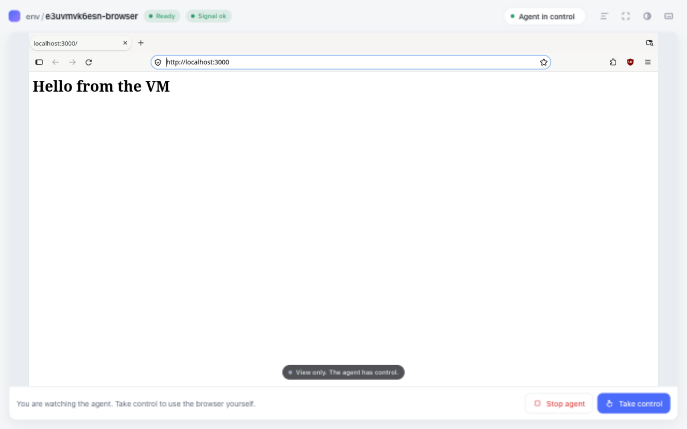

<p align="center">
  
</p>

<h1 align="center">agentos</h1>

<p align="center">
  <strong>Give your coding agent its own computer in the cloud.</strong><br>
  A fresh VM with a terminal, a real browser and your repo, opened when the agent asks for one.<br>
  Deleted when the work is done, or saved for tomorrow.
</p>

<p align="center">
  <a href="https://github.com/sabalys-ramunas/agentos/releases/latest"></a>
  <a href="https://github.com/sabalys-ramunas/agentos/actions/workflows/ci.yml"></a>
  <a href="LICENSE"></a>
  <a href="https://modelcontextprotocol.io"></a>
</p>

<p align="center">
  <a href="#install">Install</a> ·
  <a href="#how-it-works">How it works</a> ·
  <a href="#what-it-costs">Costs</a> ·
  <a href="#safe-by-default">Safety</a> ·
  <a href="#faq">FAQ</a> ·
  <a href="docs/LOCAL.md">Docs</a>
</p>

<br>

<picture>
  <source media="(prefers-color-scheme: dark)" srcset="assets/readme/how-it-works-dark.svg">
  
</picture>

## Is it for you?

agentos is for developers who already use a coding agent (**Claude Code**, **Codex** or **T3 Code**)
and want it to do more than edit files:

- ✅ **Run the app and check it in a real browser**, instead of saying it should work.
- ✅ **Keep your laptop out of it.** Installs, builds, Docker and dev servers run on the VM, which
  holds none of your keys.
- ✅ **Run several agents at once**, each on its own machine, so they never fight over ports,
  branches or `node_modules`.
- ✅ **Pick up tomorrow** where the agent stopped, with everything still installed.
- ✅ **Use its own shell on the machine**: `ssh agentos-<id>`, `rsync` and `scp`, as if it were local.

It is not another agent, chat or IDE. Your agent stays where it is, and agentos gives it a machine.

## Install

One command on macOS or Linux. It installs the latest release, then walks you through setup in the
terminal.

```sh
curl -fsSL https://raw.githubusercontent.com/sabalys-ramunas/agentos/main/scripts/install.sh | sh
```

Setup takes about five minutes: paste a Hetzner Cloud token (or use Docker), reuse your GitHub
login, and it connects Claude Code and Codex for you (and `ssh` to your agents' machines). Every step
can be skipped and changed later.

<p align="center">
  
</p>

> [!TIP]
> **Nothing bills until an agent opens a VM.** The service on your laptop is free and idle until
> then, and setup puts a monthly cap on VMs (10 EUR unless you choose another).

<details>
<summary><b>What you need</b></summary>

<br>

- macOS or Linux, with `git`
- Claude Code, Codex or T3 Code
- For the VMs, one of:
  - a [Hetzner Cloud](https://www.hetzner.com/cloud) account (about 0.011 EUR an hour while a VM is
    open). Make a project just for agentos: its token can delete any server in that project.
  - Docker running on your computer (free, less isolated)
- Optional: the [GitHub CLI](https://cli.github.com) (`gh`), so setup can reuse your login for
  private repositories

The installer puts `uv` and `agentos` in `~/.local/bin`, never asks for `sudo`, and is safe to run
again: it updates agentos in place. To install a branch or an older release, set `AGENTOS_GIT_REF`
(for example `AGENTOS_GIT_REF=v0.2.0`).

</details>

### Then ask your agent

Start a new Claude Code or Codex session and say:

> Work in agentos on github.com/you/app: fix the failing checkout test, show me the page working,
> and open a pull request.

The agent opens its computer, gives you a **live view link** to watch its browser, and comes back
with a screenshot and the pull request link. You can take over the browser at any time.

## How it works

1. **Your agent asks for a computer** when the task needs one. agentos rents a VM, clones your
   repository into it and starts a browser there.
2. **The agent works on it like on its own laptop.** It edits files, runs the tests, starts the dev
   server and opens the page in the browser, where `localhost` is the VM. It can also use its own
   shell: `ssh agentos-<id>`, `rsync` and `scp`. Dev servers keep running when agentos restarts or
   updates.
3. **It shows you the result**: screenshots kept as proof, at desktop and phone width, and a pushed
   branch with its pull request link. Pushes go through agentos, so the VM never holds your key.
4. **The VM goes away.** A one-off fix deletes it. Longer work saves the whole machine and deletes
   the VM, so it costs cents a month until an agent picks it up again.

The thinking stays on your laptop, in the agent you already use. agentos only rents the machines,
and only while an agent works in one.

## Keep a computer between chats

Each computer has a title. Say *"continue the checkout fix in agentos"* in any new chat, and the
agent gets the same machine back: the branch, the files, `node_modules`, Docker volumes and the dev
server, plus the note the last agent left.

| | Good for | While nobody uses it |
|:--|:--|:--|
| 🧹 **Single use** (the default) | a quick fix: work, push, done | nothing: the VM is deleted |
| 💾 **Saves when idle** | work that spans days, or "keep it" | cents a month: the machine is saved and the VM deleted, back in about a minute |
| ⚡ **Kept running** | a machine that is always on | billed every hour (about 7.80 EUR a month), and only after you allow it |

You choose the default in setup. The agent picks per task, and never keeps one running unless you
asked for it.

## What it costs

agentos itself is free and open source. You pay your VM provider directly, with your own account.

| | Price |
|:--|:--|
| A VM while it is open (Hetzner `cx23`: 2 CPU, 4 GB) | about **0.011 EUR an hour** |
| A task under an hour, from open to pull request | about **0.01 EUR** |
| A saved computer (about 4 GB) | about **0.05 EUR a month** |
| A computer kept running all month | about **7.80 EUR a month** |
| Docker on your own computer | **free** |

Setup sets limits that hold whatever an agent asks: **10 EUR a month, 4 hours per VM, 2 VMs at
once**. Change them any time with `agentos setup limits`. The agent sees the cost so far, and so do
you.

## Safe by default

- 🔑 **No keys on the VM.** Your GitHub and Hetzner tokens stay on your laptop. A push from the VM
  goes through agentos with a token for that one repository, which dies with the VM.
- 🌿 **Your branches are safe.** The agent pushes new branches. It never deletes or rewrites your
  default branch, protected branches, tags, or branches someone else pushed.
- 🧱 **Commands only on the VM.** The agent's commands run in its environment, never on your laptop.
- 🔒 **One chat per machine.** Each machine answers only the chat that opened it, so two agents never
  work on the same computer by accident.
- ✍️ **Commits are yours.** With your GitHub login saved, commits carry your GitHub name and noreply
  address, so they link to your account without showing your email.
- 👀 **You can always watch.** Every environment has a live view of its browser, and you can take
  over with one click.
- 💶 **Hard limits.** Past the monthly cap, the time limit or the VM count, opening is refused.
- 🗑️ **Nothing left behind.** An idle environment is closed after an hour. A kept one is saved
  first, and work that was never pushed gets a rescue save instead of being lost.

What this defends against, and what it does not: [docs/THREAT-MODEL.md](docs/THREAT-MODEL.md).

## Works with

| Agent | Setup |
|:--|:--|
| **Claude Code** | connected by `agentos setup`, with the agentos skills |
| **Codex** | connected by `agentos setup` |
| **T3 Code** | nothing more: it uses Claude Code's and Codex's settings, and shows the live view in its preview pane |
| **Any MCP client** (Cursor, for example) | by hand: Streamable HTTP at `http://127.0.0.1:7410/mcp`, with the token setup keeps for your agents |

## Watch it work

agentos has a small web app at `http://127.0.0.1:7410/` that lists every environment, what each
costs and how long it has left. Each one has a page with its live browser, the proof screenshots,
the commands it ran and its pushed branches.

The one-line install does not include the web app: it is built from a checkout with Node.js 22 and
pnpm ([web/README.md](web/README.md)). Without it, `http://127.0.0.1:7410/` says so, and every
environment still has its live view link, and `agentos environments list` in the terminal.

<picture>
  <source media="(prefers-color-scheme: dark)" srcset="assets/readme/environment-dark.png">
  
</picture>

<details>
<summary><b>More screenshots</b>: the environments list and the live view</summary>

<br>

<picture>
  <source media="(prefers-color-scheme: dark)" srcset="assets/readme/environments-dark.png">
  
</picture>

The live view link works on its own, without the web app. Here the VM's browser shows its own
`localhost:3000`, and **Take control** lets you drive it:




</details>

## FAQ

<details>
<summary><b>How is this different from running the agent on my laptop?</b></summary>

<br>

The agent still runs where it runs now. Only its work moves: the commands, the dev server and the
browser run on a VM that holds none of your keys or accounts. So it can work without asking you at
every step, several agents can work at once, and your laptop stays free.

</details>

<details>
<summary><b>How is it different from E2B, Daytona or GitHub Codespaces?</b></summary>

<br>

E2B and Daytona are sandbox platforms your own code drives through an SDK; they fit when you build
a product that runs code for your users. Codespaces is a hosted editor for a person. agentos is for
the agent in your chat: an MCP server the agent calls itself, with a real browser you can watch and
take over, git through agentos so the key stays off the machine, and limits on a computer you own.
No agentos account, and no hosted service in between.

</details>

<details>
<summary><b>Is my code on the VM? Are my keys?</b></summary>

<br>

Your code is: the repository is cloned there, or the agent uploads its local checkout, so it can
work on it. A saved environment keeps that code in a snapshot in your own Hetzner account until you
forget it. Your keys are not: no token, password or account ever reaches the VM.

</details>

<details>
<summary><b>Does my laptop need to stay on?</b></summary>

<br>

Yes, while an agent works. The agent runs on your laptop and reaches its VM through agentos there.
When the laptop sleeps, an environment that saves when idle is saved and its VM deleted, so nothing
bills overnight. A dev server on the VM keeps running while agentos restarts or updates. For
machines that keep working while you sleep, run agentos on a server (below).

</details>

<details>
<summary><b>Can it work on private repositories?</b></summary>

<br>

Yes. With your GitHub login saved in setup, it can clone and push any repository that login can
reach. Without one, the agent gives you a link to a page where you paste a token for that
repository. The token never goes through the chat, and the agent never sees it.

</details>

<details>
<summary><b>Which VM providers are supported?</b></summary>

<br>

Hetzner Cloud, Morph Cloud (machines start in about a second, and a saved environment pauses with
its memory, so it comes back in seconds with its dev server still running), and Docker on your own
computer. Each uses your own account. The provider layer (`agentos.vms`) is small, and more providers
are welcome.

</details>

<details>
<summary><b>How do I update or remove it?</b></summary>

<br>

Update: run the install command again. Remove: see [docs/LOCAL.md](docs/LOCAL.md#remove-it)
(forget the saves you no longer need first, so no snapshot stays in your Hetzner account).

</details>

## Run it on a server

<details>
<summary><b>Always on, without your laptop</b></summary>

<br>

A server keeps working while your laptop sleeps. It can also run logged-in browser lanes for your
own accounts and studio's page checks (`ui_check`). A node is a small Linux VPS (Ubuntu 22.04 or
later, or Debian 12). On the node:

```sh
git clone https://github.com/sabalys-ramunas/agentos && cd agentos
sudo deploy/install-node.sh --systemd --user agentos --hardened
sudo agentos vm setup                      # paste the Hetzner token
sudo agentos vm image build dev            # the snapshot each VM boots from
sudo agentos environments setup            # says what is still missing
```

Then on your computer, with the node in `~/.ssh/config` as `mynode`:

```sh
curl -fsSL https://raw.githubusercontent.com/sabalys-ramunas/agentos/main/scripts/install.sh | sh
agentos connect mynode
```

Install, hardening, backups and upgrades: [deploy/README.md](deploy/README.md).

</details>

## For agents: the tools

<details>
<summary><b>What the agent gets</b>: an MCP server with a short everyday list</summary>

<br>

| Tool | What it does |
|:--|:--|
| `environment_open(title, repo, keep)` | opens a computer (or resumes the one with that title) with the repo in `/work/<name>` and a browser; returns `on`, which every later call carries |
| `environment()` | what is open and saved, the cost so far, ports, git, and the pull request link |
| `environment_close(note)` | ends it: deleted, or saved with a note for the next agent |
| `environment_save(note)` | saves the whole machine now, before a risky step |
| `environment_upload()`, `environment_download(path)` | one-use links to send a local checkout up, or a file down to you |
| `lane_file_read`, `lane_file_edit`, `lane_exec` | read and edit code, run a command on the VM |
| `lane_job_start`, `lane_job_read(until_port=3000)` | dev servers and long jobs; wait until a port listens |
| `ssh agentos-<id>` (local mode) | the agent's own shell on the machine, with `scp` and `rsync` |
| `browser_navigate`, `browser_snapshot`, `browser_act` | the VM's browser: read the page as an outline, act by reference |
| `browser_screenshot(proof=...)` | a screenshot kept as proof, at desktop or phone width |

About 150 more tools load in groups when the agent needs them: [docs/TOOLS.md](docs/TOOLS.md). The
skill that teaches an agent the loop:
[agentos-environment](src/agentos/client/skills/agentos-environment/SKILL.md).

</details>

## Status

> [!NOTE]
> **Alpha.** Environments and saved environments are new, and the tools may still change between
> minor versions: see the [changelog](CHANGELOG.md) and the
> [releases](https://github.com/sabalys-ramunas/agentos/releases). On a laptop there are no account
> browser lanes or `ui_check` yet (both need a server), and the laptop must be awake while a VM
> works.

## Docs

| | |
|:--|:--|
| [docs/LOCAL.md](docs/LOCAL.md) | agentos on your laptop: the service, sleep, costs, where tokens live |
| [docs/ENVIRONMENTS.md](docs/ENVIRONMENTS.md) | environments in depth: setup, limits, troubleshooting |
| [docs/TOOLS.md](docs/TOOLS.md), [docs/ERRORS.md](docs/ERRORS.md) | every MCP tool, every error code and its fix |
| [docs/GIT.md](docs/GIT.md) | how git works through agentos |
| [deploy/README.md](deploy/README.md) | running agentos on a server |
| [docs/THREAT-MODEL.md](docs/THREAT-MODEL.md) | what it defends against |
| [docs/ARCHITECTURE.md](docs/ARCHITECTURE.md), [docs/VISION.md](docs/VISION.md) | how it is built, and where it is going |
| [docs/DEVELOPING.md](docs/DEVELOPING.md) | the dev loop and the tests |

## Contributing

Issues and pull requests are welcome. [CONTRIBUTING.md](CONTRIBUTING.md) has the dev loop: no cloud
account needed (`uv run agentos dev up` and the unit tests run on a laptop). For a security
problem, see [SECURITY.md](SECURITY.md) and report it privately.

## License

Apache License 2.0: see [LICENSE](LICENSE) and [NOTICE](NOTICE).
