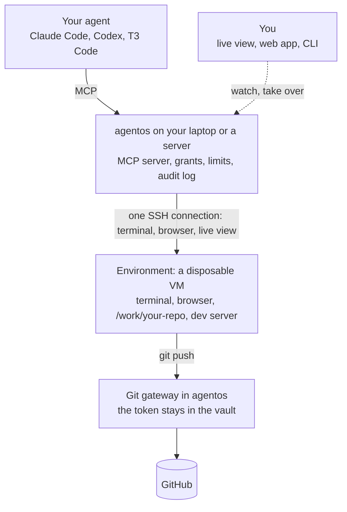

<p align="center">
  
</p>

<h1 align="center">agentos</h1>

<p align="center">
  <strong>Your agent's own computer, and it stays.</strong><br>
  A cloud VM with a terminal and a real browser for Claude Code, Codex and any MCP client.
  Single use, or kept for tomorrow. Self-hosted, open source.
</p>

<p align="center">
  <a href="https://github.com/sabalys-ramunas/agentos/actions/workflows/ci.yml"></a>
  <a href="LICENSE"></a>
  
  <a href="https://modelcontextprotocol.io"></a>
</p>

You open a chat and hand your coding agent a task to do in agentos. It asks for an
**environment**: its own computer in the cloud, with your repository, a terminal and a browser.
There it changes the code, runs the tests, opens the page and keeps a screenshot of it as proof.
Then it pushes a branch and gives you the pull request link. You watch its browser live, and take
over whenever you like.

A quick fix uses a machine once, and the VM is deleted. Longer work keeps its machine: when it goes
idle, agentos saves the whole machine and deletes the VM. Tomorrow, in any chat, you say "continue
the shop in agentos", and it comes back as it was: the tools, the Docker volumes, `node_modules` and
the dev server. The agent itself (its thinking) stays on your laptop, in Claude Code, Codex or T3
Code. agentos runs next to it and rents the machines.

<picture>
  <source media="(prefers-color-scheme: dark)" srcset="assets/readme/environment-dark.png">
  
</picture>

agentos is not another agent, chat or IDE. It is an [MCP server](https://modelcontextprotocol.io)
(Model Context Protocol) that runs on your laptop (or a server you own) and rents machines for the
agent you already use.

## Three ways an environment stays

| | When | While nobody uses it |
|---|---|---|
| **Single use** (`keep="none"`, the default) | a one-off fix: work, push, close | nothing: the VM is deleted |
| **Saves when idle** (`keep="save"`) | work that spans sessions, or you say "keep it" | cents a month for the save; the VM is deleted and comes back when an agent opens it again |
| **Kept running** (`keep="live"`) | you want a machine that is always on | every hour, about 7.80 EUR a month for a `cx23`; you allow it first (`agentos environments allow --keep-live`) |

An agent opens an environment with a title. Opening the same title again, from any chat, brings it
back. It saves before a risky step and when it stops for the day, and it tells you how to come back.
Saves you are done with are forgotten with one click in the web app.

## How it works



1. The agent calls `environment_open(title="Fix checkout", repo="github.com/you/shop")`. agentos
   rents a VM (Hetzner Cloud, or a Docker container on your own computer), clones the repository
   into `/work/shop` and starts a browser on that VM. Code that is only on your laptop (a branch
   with uncommitted changes) goes up with `environment_upload`: a one-use link the agent sends a
   tarball to from its own shell. `environment_download(path)` gives you a one-use link to a file
   or folder the agent made.
2. Calls without a target go to that environment: `lane_file_read` and `lane_file_edit` for the
   code, `lane_exec(cmd="npm test", cwd="/work/shop")`,
   `lane_job_start(cmd="npm run dev", cwd="/work/shop")`,
   `browser_navigate(url="http://localhost:3000")`. In the browser, `localhost` is the VM.
3. `browser_screenshot(proof="checkout after the fix")` keeps a screenshot as proof, at desktop
   width or `width=390` for a phone. The agent gives you its link, and the environment's page in
   the web app shows it.
4. `git push` on the VM goes through agentos's git gateway. The VM never holds your key, only a
   token for that one repository, which dies with the environment. `environment()` then gives the
   GitHub link that opens a pull request for the branch.
5. `environment_close()` ends it. A single-use one refuses while work is not pushed, then deletes
   the VM and says `machine: "deleted"`. A kept one is saved first (`keep="save"`) or stays running
   (`keep="live"`). If the agent forgets, agentos closes it when it sits idle or reaches its time
   limit, and saves it first when it is kept.
6. `environment_open` with the same title, in a new chat, resumes a saved one and says what came
   back (`resumed`): the branch, the commits, the files, the services that ran, and the note the
   last agent left.

**Private repositories.** With your GitHub login saved in `agentos setup`, an environment can clone
any repository that login reaches, a collaborator's one too. Without it, `environment_open` on a
private repository returns a link to a card where you paste a token. agentos checks it with GitHub
and keeps it; the agent never sees it, and it never goes through the chat.

**A real run on a laptop**, with agentos running locally on a Mac: the agent opened a Hetzner `cx23`
for a private repository (cloned through the owner's GitHub login), ran the web app on the VM, and
the browser on the VM kept proof screenshots at desktop and phone width. A local checkout went up
with `environment_upload`, and `environment_close` deleted the VM. 6 minutes, 0.01 EUR.

An earlier run changed this repository's web app with the file tools, ran its tests on the VM and
pushed a branch through the gateway; a delete and a force push of a branch it had not created were
refused.

In an earlier run, `ui_check` found text at 4.47:1 contrast (WCAG AA asks for 4.5:1). The agent
fixed it on the VM, `ui_check` confirmed the fix, and the branch went up: 13 minutes, 0.01 EUR.

## Why not just run the agent on your laptop?

- **Your laptop stays yours.** Hand the task off: builds, test suites, dev servers and browsers
  run on the VM, not on your laptop.
- **It stays.** A long job keeps its machine between chats, with everything installed, for cents a
  month while it waits.
- **Proof, not a promise.** The agent shows you what it built: screenshots agentos keeps for you, at
  desktop and phone width, and the pull request link for its branch.
- **Nothing the agent runs can reach your keys or accounts.** The VM holds no login, no key and no
  password, so it can run anything without asking you each time.
- **A real browser.** The agent sees its own dev server the way a user would, and so do you.
- **Clean when you want it.** A single-use environment starts fresh and is deleted when it is
  done: no leftovers from the last task, no "works on my machine".

## Quickstart: on your laptop (5 minutes)

You need macOS or Linux, git, and [Claude Code](https://claude.com/claude-code) or Codex. For the
VMs, a [Hetzner Cloud](https://www.hetzner.com/cloud) account (a `cx23` is about 0.011 EUR an hour
while it is open), or Docker running on your laptop (free, less isolated).

```sh
curl -fsSL https://raw.githubusercontent.com/sabalys-ramunas/agentos/main/scripts/install.sh | sh
```

The install ends in `agentos setup`: a few questions in the terminal. Quick start takes good
defaults; step by step lets you choose each one. Every step can be skipped.

1. **Where VMs come from.** Paste a Hetzner Cloud API token (it is checked at once), or use Docker,
   which builds its machine image once. Make the token in a Hetzner project that holds only these
   VMs: a project token can delete every server in its project. With Hetzner, setup offers to build
   the `dev` snapshot (a few minutes, a cent or two), so each VM boots with its browser ready.
2. **GitHub.** Use your `gh` login, sign in with `gh` now, paste a token, or skip (public
   repositories only). Then one question: may environments clone and push any repository this
   login can reach? The push rules still hold either way.
3. **Limits.** 10 EUR a month, 4 hours per VM and 2 VMs at once, unless you choose others. Then
   one question: single use, or saves when idle? Kept running is explained, and is only allowed
   when you choose it.
4. **Your agents.** A small agentos service starts on your laptop, and Claude Code and Codex are
   connected to it, with the skills.
5. **A health check** of each piece, and a test VM if you say yes (about 0.01 EUR).

Then start a new Claude Code session and ask:

> Work in agentos on github.com/you/app: start the dev server, check the home page in the browser,
> fix what you find, push a branch and close the environment.

The agent gives you a live view link to watch its browser. `agentos environments list` shows what
is open, and `agentos environments close ID` closes one. To change one thing later, run its step
again: `agentos setup github` (or `vms`, `limits`, `agents`, `check`, `test-vm`).

### What local mode means

- **Nothing bills while no VM is open.** The service on your laptop serves MCP to your agents, and
  rents a VM only when an agent calls `environment_open`.
- **The browser runs on the VM.** Your laptop downloads no browser. agentos drives the VM's browser
  and shows you its live view. Without the `dev` snapshot, each VM installs the browser when it
  opens, which adds 2 to 4 minutes.
- **Your laptop must be awake while a VM works.** The agent runs on your laptop, and the commands,
  the browser and git reach the VM through the service there. No agent works while the lid is
  closed in this version.
- **Sleep saves a kept one.** When the laptop goes to sleep, an environment that saves when idle is
  saved and its VM deleted. A single-use one with unsaved work gets a rescue save, and you are
  told. A VM kept running keeps billing; one left open with nothing to save bills until the laptop
  wakes and the time limit or the idle limit closes it.
- **Your tokens stay on your laptop.** The Hetzner token and your GitHub token are kept in
  `~/.agentos` (the GitHub one sealed in the agentos vault) and never reach the VM. A push from the
  VM goes through agentos on your laptop, with a token for that one repository.

More on local mode: [docs/LOCAL.md](docs/LOCAL.md).

## Run it on a server (always on, account browsers)

A server keeps working while your laptop sleeps, and it can also run logged-in browser lanes for
your own accounts. A node is a Linux machine that runs agentos: Ubuntu 22.04 or later, or Debian 12,
x86_64 or arm64 (a small VPS is enough). Make a Hetzner Cloud project that holds nothing but these
VMs, and a read-write API token in it. On the node:

```sh
git clone https://github.com/sabalys-ramunas/agentos && cd agentos
sudo deploy/install-node.sh --systemd --user agentos --hardened
sudo agentos vm setup                      # paste the Hetzner token
sudo agentos vm image build dev            # a snapshot with git, build tools, Python, Node 22, Docker
sudo agentos environments repo add github.com/you/app   # a deploy key to paste, or --token
sudo agentos environments setup            # says what is still missing, and the command that fixes it
```

Then, from your computer (the node in your `~/.ssh/config` as `mynode`):

```sh
curl -fsSL https://raw.githubusercontent.com/sabalys-ramunas/agentos/main/scripts/install.sh | sh
agentos connect mynode
```

`connect` keeps an SSH tunnel to the node, gives your agents a grant of their own (kept in the
macOS Keychain or a chmod 600 file), registers the MCP server with Claude Code and Codex, and
installs the Claude Code skills. The node rents the cheapest server type that fits, unless you set
a size. Install, hardening, backups and upgrades: [deploy/README.md](deploy/README.md).

## Works with

| Client | How it connects |
|---|---|
| **Claude Code** | `agentos setup` (or `agentos connect` for a server) registers it (`claude mcp add-json`) and installs the `agentos-environment`, `agentos-studio`, `agentos-lanes` and `agentos-offload` skills |
| **Codex** | `agentos setup` adds it to `~/.codex/config.toml` (for a server, `agentos connect`, through the stdio bridge `agentos mcp-bridge`) |
| **T3 Code** | nothing more: its Claude threads read Claude Code's settings and its Codex threads read Codex's; open the live view in its preview pane |
| **Any other MCP client** (Cursor, for example) | by hand: the node's MCP URL over Streamable HTTP with a grant token; `agentos connect --by-hand` on the node prints the steps |

## What the agent gets

| Tool | What it does |
|---|---|
| `environment_open(title, repo, ref, size, hours, keep)` | rents the VM (`size`: small, medium, large, xlarge), clones the repo into `/work/<name>`, opens the browser; returns the live view link for you. `keep`: `none`, `save` or `live`. The same title again resumes a saved one (`resumed`). A private repo it cannot read returns a card link for you instead (`approval_pending`), and nothing is rented |
| `environment_save(note)` | saves the whole machine now (a disk snapshot plus the files), with a note for the next agent |
| `environment_forget(title)` | deletes the saves and snapshots of an environment that is done with |
| `environment_download(path)` | a one-use link for you to a file or folder in `/work` |
| `environment_upload(dest)` | a one-use link, valid 15 minutes, for a tarball of a local checkout: the agent packs and sends it from its own shell (reached with `tools_call`) |
| `environment()` | state, time left, cost so far, listening ports, git (branch, ahead, dirty, pushed, and `compare`: the link that opens a pull request), proofs, the last calls; with nothing open, the open and saved ones by title |
| `environment_close(discard=False, final=False)` | single use: refuses with `unsaved_work` while anything is not pushed, then deletes the VM. Saves when idle: saves, then deletes the VM. Kept running: stays on unless `final=True` |
| `lane_file_read`, `lane_file_write`, `lane_file_edit` | read a file with line numbers, write a whole one, or replace exact text in one |
| `lane_exec(cmd, cwd)` | a command on the VM, with its output (16 KB by default, `max_bytes` for more) |
| `lane_job_start`, `lane_job_read`, `lane_job_cancel` | long jobs and dev servers on the VM; `lane_job_read(until_exit=true)` waits for one to finish |
| `browser_navigate`, `browser_snapshot`, `browser_act` | the environment's browser: read the page as an outline, act by reference |
| `browser_screenshot(proof=..., width=..., full_page=...)` | a screenshot; with `proof`, kept on the node with a link for you (desktop width by default, `width=390` for a phone) |
| `ui_check(url)` | studio's page check at each width and theme: layout, contrast, tap targets, names, page health (on a server; not in local mode yet) |

About 150 more tools, grouped in toolsets the agent loads when it needs them, are listed in
[docs/TOOLS.md](docs/TOOLS.md).

## Safety, in plain words

- **No key on the VM.** Git goes through agentos's gateway (on your laptop, or on the node), which
  keeps the credential in its vault. The VM holds one gateway token: good for the repository it was
  opened with, only through its own tunnel, and only while it is open. It may push new branches, and
  rewrite or delete the ones it created while nobody else has pushed to them. The default branch,
  protected branches, other people's branches and tags are never deleted or rewritten from an
  environment.
- **Commands only in environments.** By default, the grant your agents get runs commands in their
  environments only, never on the computer agentos runs on.
- **Nothing inside asks you.** Because the VM holds nothing worth stealing, commands, the browser
  and pushes there never wait for a person, even after the agent read a web page.
- **Limits instead of questions.** On a laptop, `agentos setup` sets at most 2 environments open at
  once, 4 hours each, and 10 EUR a month; a server's defaults are 3, 8 hours and 50 EUR. Past a
  limit the open is refused, whatever the agent read. Set your own with
  `agentos environments allow --max-live 2 --max-hours 4 --monthly-eur 20`
  ([the limits](docs/ENVIRONMENTS.md#4-the-limits)).
- **Deleted or saved when done.** agentos closes a forgotten environment after an idle hour or at
  its time limit. A kept one is saved first. A single-use one with unsaved work is never deleted
  for being idle: it waits to its time limit, gets a rescue save, and you are told.
- **Always-on costs are your choice.** A VM kept running bills every hour, so an agent can keep one
  only after you allowed it.
- **One agent's machine.** Only the agent that opened an environment can see it or act on it. You
  see and close every one.
- **The audit log.** Every call, tied to the grant that allowed it. `agentos access freeze node`
  stops every agent at once.
- **Your own accounts stay behind a person.** Logged-in browser lanes for your accounts are a
  separate feature, and there posts, payments and secrets after untrusted text still ask you.

What this defends against, and what it does not: [docs/THREAT-MODEL.md](docs/THREAT-MODEL.md).

## Watch it work

The web app (`web/`, served by agentos at `/`: `http://127.0.0.1:7410/` on a laptop) lists every
environment with its state, how it stays (single use, kept running, saves when idle), repository,
agent, cost and time left. Under Saved are the saves of kept ones: when each was saved, its size,
what it costs a month and the agent's note, with Forget. Each environment has a page with its live
browser, the proof screenshots, terminal commands, git (each pushed branch links its pull request)
and ports. Build it once with Node.js 22 and pnpm:
`cd web && pnpm install --frozen-lockfile && pnpm build` ([web/README.md](web/README.md)).

<picture>
  <source media="(prefers-color-scheme: dark)" srcset="assets/readme/environments-dark.png">
  
</picture>

Without a build, the live view link the agent gives you works on its own. Here is the live view
of a real environment on Hetzner: its browser shows the VM's own `localhost:3000`, and
**Take control** lets you drive it:


The CLI shows the same: `agentos environments list`, `show ID` and `close ID`.

## More features

- **Studio page checks**: `ui_check`, `ui_diff` and `system_check` measure the pages you build at
  each width and theme, and say what a change did ([docs/STUDIO.md](docs/STUDIO.md)).
- **Profiles and brand**: who the work is for, with tokens and rules that `ui_check` measures
  ([docs/PROFILES.md](docs/PROFILES.md)).
- **Browser lanes for your own accounts**: persistent, logged-in browsers with their own proxy,
  which you watch and take over ([docs/PROXIES.md](docs/PROXIES.md),
  [docs/RESPONSIBLE-USE.md](docs/RESPONSIBLE-USE.md)).
- **Routines**: flows you record and replay, and workflows on a schedule
  ([docs/WORKFLOWS.md](docs/WORKFLOWS.md)).

## FAQ

### How is this different from running the agent locally?
The agent still runs where it runs now (your terminal, T3 Code, Codex). Only its work moves: the
commands, the dev server and the browser run on a VM that holds none of your keys or accounts, so
it can work without asking you at each step, and your laptop stays free.

### How is it different from E2B, Daytona or GitHub Codespaces?
E2B and Daytona are sandbox platforms that your own code drives through their SDKs and APIs; they
fit well when you build a product that runs code for your users. Codespaces is a hosted dev
environment for a person in an editor. agentos is for the agent in your chat: it is an MCP server
the agent calls itself, with a real browser you can watch and take over, git through a gateway so
the key stays off the machine, and limits and an audit log on a computer you own.

### What does it cost?
agentos is free (Apache-2.0). You pay your provider: Docker costs nothing, and a Hetzner `cx23`
(2 vCPU, 4 GB) is about 0.011 EUR an hour, billed per started hour. The real run above, 13 minutes
from open to close, cost 0.01 EUR. A saved environment costs only its snapshot, about 0.012 EUR per
GB a month (a few cents). One kept running costs every hour, about 7.80 EUR a month for a `cx23`.
`environment()` and the web app show the cost so far.

### Is my code or my key on the VM?
Your code is: the repository is cloned there (or the agent uploads its local checkout), so the
agent can work on it. A saved environment keeps that code in a snapshot in your own provider
account until you forget it. Your key is not on the VM, and neither is any token, password or
account. Pushes go through agentos (on your laptop or server), which holds the key.

### Can I self-host it?
It is self-hosted. agentos runs on your laptop or your own Linux server, and the VMs are rented with
your own provider account. There is no agentos account and no hosted service in the loop.

### Which providers are supported?
Docker (any computer with Docker) and Hetzner Cloud. The provider layer (`agentos.vms`) is small,
and more are welcome.

### Which agents work with it?
Claude Code and Codex are set up by `agentos setup` (or `agentos connect` for a server); T3 Code
uses both. Any client that speaks MCP
over HTTP can connect by hand (see [Works with](#works-with)).

## Status

**Alpha.** Environments are new in 0.1.0, and kept environments are newer; expect the most change
there. Local mode has no `ui_check` and no account browser lanes yet (both need a server today). In
local mode the laptop must be awake while a VM works, and no agent runs while it is closed. Not
yet: providers other than Docker and Hetzner, and a link to a VM's port on your own computer (you
see it through the environment's browser). The full list:
[docs/ENVIRONMENTS.md](docs/ENVIRONMENTS.md#limits) and
[docs/ARCHITECTURE.md](docs/ARCHITECTURE.md#not-built-yet).

## Docs

| | |
|---|---|
| [docs/LOCAL.md](docs/LOCAL.md) | local mode: the service on your laptop, sleep, costs, where tokens live |
| [docs/ENVIRONMENTS.md](docs/ENVIRONMENTS.md) | environments: setup, use, costs, limits, troubleshooting |
| [docs/design/environments.md](docs/design/environments.md) | the design and the exact tool shapes |
| [docs/GIT.md](docs/GIT.md) | git through the node: keys in the vault, declared repositories |
| [deploy/README.md](deploy/README.md) | install, harden, back up and upgrade a node |
| [docs/NODE-TEMPLATES.md](docs/NODE-TEMPLATES.md) | Hetzner, home box and Mac mini templates |
| [docs/TOOLS.md](docs/TOOLS.md), [docs/ERRORS.md](docs/ERRORS.md) | every MCP tool, every error code and its fix (generated) |
| [docs/STUDIO.md](docs/STUDIO.md) | studio's page checks |
| [docs/ARCHITECTURE.md](docs/ARCHITECTURE.md), [docs/VISION.md](docs/VISION.md) | how it is built, and where it is going |
| [docs/THREAT-MODEL.md](docs/THREAT-MODEL.md), [docs/PRINCIPLES.md](docs/PRINCIPLES.md) | what it defends against, and the lines it will not cross |
| [docs/DEVELOPING.md](docs/DEVELOPING.md) | the dev loop, the tests, the fake node, environments on Docker with `agentos dev up` |
| [docs/design/README.md](docs/design/README.md) | the design docs, with what is built and what is not |

## Contributing

Issues and pull requests are welcome. [CONTRIBUTING.md](CONTRIBUTING.md) has the dev loop (no
cloud account needed: `uv run agentos dev up` and the unit tests run on a laptop). For a security
problem, see [SECURITY.md](SECURITY.md) and report it privately.

## License

Apache License 2.0: see [LICENSE](LICENSE) and [NOTICE](NOTICE).
