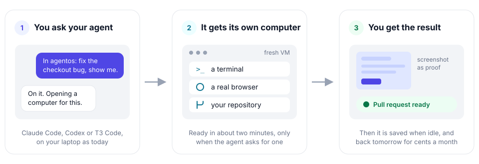
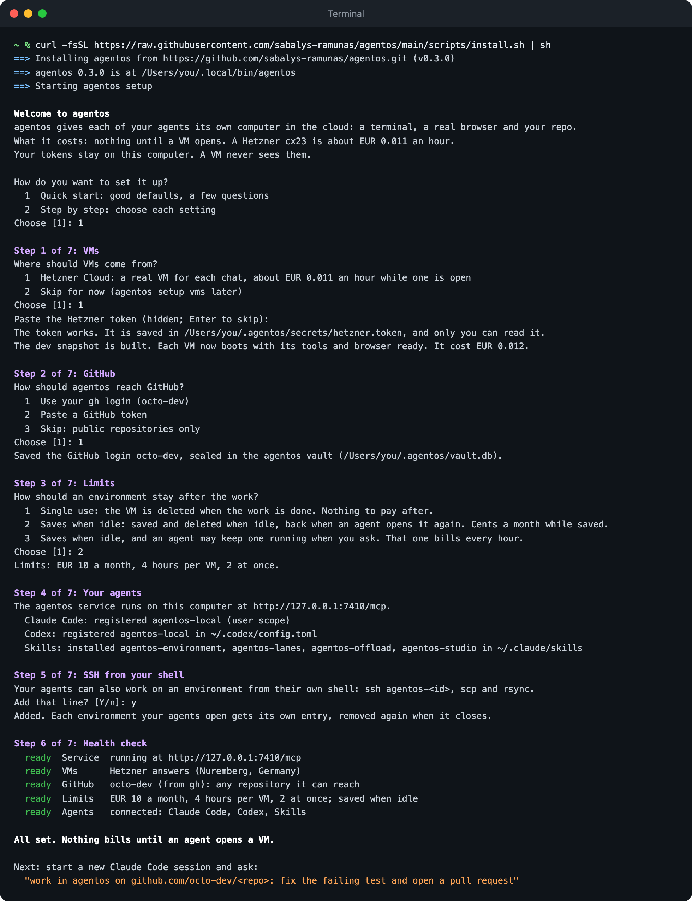
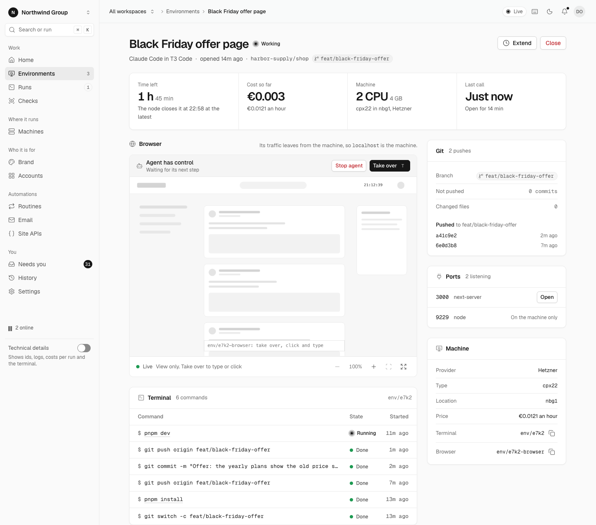

<p align="center">
  
</p>

<h1 align="center">agentos</h1>

<p align="center">
  <strong>A computer for your agent, with a browser, a terminal and a disk that stay.</strong><br>
  For Claude Code, Codex or any MCP agent, on machines in your own account. It saves when idle<br>
  and comes back in the next chat, signed in with logins from your vault the model never sees.
</p>

<p align="center">
  <a href="https://github.com/sabalys-ramunas/agentos/releases/latest"></a>
  <a href="https://github.com/sabalys-ramunas/agentos/actions/workflows/ci.yml"></a>
  <a href="LICENSE"></a>
  <a href="https://modelcontextprotocol.io"></a>
</p>

<p align="center">
  <a href="#install">Install</a> ·
  <a href="#how-it-works">How it works</a> ·
  <a href="#signed-in-without-showing-a-password">Logins</a> ·
  <a href="#what-it-costs">Costs</a> ·
  <a href="#safe-by-default">Safety</a> ·
  <a href="#faq">FAQ</a> ·
  <a href="docs/LOCAL.md">Docs</a>
</p>

<br>

<picture>
  <source media="(prefers-color-scheme: dark)" srcset="assets/readme/how-it-works-dark.svg">
  
</picture>

## Is it for you?

agentos is for people who already use an agent (**Claude Code**, **Codex**, **T3 Code** or any MCP
client) and want it to have a computer of its own, one that is still there tomorrow:

- ✅ **A computer that stays.** Its installs, its branch, its dev server and its browser are there
  in the next chat. It saves itself when idle, so a quiet computer costs cents a month.
- ✅ **A browser it can stay signed in to.** It opens the accounts it works with (a dashboard, an
  admin page, a test shop) and acts there when the work needs it. Logins come from your own vault,
  and the model never sees them.
- ✅ **Run the app and check it in a real browser**, instead of saying it should work.
- ✅ **Keep your laptop out of it.** Installs, builds, Docker and dev servers run on the machine,
  and no key sits there.
- ✅ **One computer per agent.** Several agents work at once, each on its own machine, so they never
  fight over ports, branches, cookies or `node_modules`.
- ✅ **Use its own shell on the machine**: `ssh agentos-<id>`, `rsync` and `scp`, as if it were local.

It is not another agent, chat or IDE. Your agent stays where it is, and agentos gives it a computer.

## Install

One command on macOS or Linux. It installs the latest release, then walks you through setup in the
terminal.

```sh
curl -fsSL https://raw.githubusercontent.com/sabalys-ramunas/agentos/main/scripts/install.sh | sh
```

Setup takes about five minutes: paste a Hetzner Cloud token (or use Docker), reuse your GitHub
login, and it connects Claude Code and Codex for you (and `ssh` to your agents' machines). Every step
can be skipped and changed later.

<p align="center">
  
</p>

> [!TIP]
> **Nothing bills until an agent opens a VM.** The service on your laptop is free and idle until
> then, and setup puts a monthly cap on VMs (10 EUR unless you choose another).

<details>
<summary><b>What you need</b></summary>

<br>

- macOS or Linux, with `git`
- Claude Code, Codex or T3 Code
- For the VMs, one of:
  - a [Hetzner Cloud](https://www.hetzner.com/cloud) account (about 0.011 EUR an hour while a VM is
    open). Make a project just for agentos: its token can delete any server in that project.
  - Docker running on your computer (free, less isolated)
- Optional: the [GitHub CLI](https://cli.github.com) (`gh`), so setup can reuse your login for
  private repositories

The installer puts `uv` and `agentos` in `~/.local/bin`, never asks for `sudo`, and is safe to run
again: it updates agentos in place. To install a branch or an older release, set `AGENTOS_GIT_REF`
(for example `AGENTOS_GIT_REF=v0.2.0`).

</details>

### Then ask your agent

Start a new Claude Code or Codex session and say:

> Work in agentos on github.com/you/app: fix the failing checkout test, show me the page working,
> and open a pull request.

The agent opens its computer, gives you a **live view link** to watch its browser, and comes back
with a screenshot and the pull request link. You can take over the browser at any time.

## How it works

1. **Your agent asks for its computer** when the task needs one. agentos rents a VM in your own
   account (Hetzner or Morph) or starts a Docker container, clones your repository into it and
   starts a browser there.
2. **The agent works on it like on its own laptop.** It edits files, runs the tests in its
   terminal, starts the dev server and opens the page in its browser, where `localhost` is the
   machine. It can also use its own shell: `ssh agentos-<id>`, `rsync` and `scp`. Dev servers keep
   running when agentos restarts or updates.
3. **It signs in when it needs to.** On a sign-in page it asks agentos, which types a login you
   chose from your vault into its browser. The model never sees the password.
4. **It shows you the result**: screenshots and videos kept as proof, and a pushed branch with its
   pull request. Pushes go through agentos, so the machine never holds your key.
5. **It stays.** When the agent goes idle or stops for the day, the whole machine is saved and the
   VM deleted, so it costs cents a month. The next chat that asks for it by its title gets it back:
   in seconds on Morph, in about a minute on Hetzner.

The thinking stays on your laptop, in the agent you already use. agentos rents the machines in
your account, and bills you nothing of its own.

## Keep it and come back

Each computer has a title. Say *"continue the checkout fix in agentos"* in any new chat, and the
agent gets the same machine back: the branch, the files, `node_modules`, Docker volumes, the dev
server and the browser's sign-ins, plus the note the last agent left.

| | Good for | While nobody uses it |
|:--|:--|:--|
| 💾 **Saves when idle** (the default) | a computer that stays: work that spans days, accounts it stays signed in to | cents a month: the machine is saved and the VM deleted, back in seconds on Morph or about a minute on Hetzner |
| 🧹 **Single use** | a quick fix: work, push, done | nothing: the VM is deleted |
| ⚡ **Kept running** | a machine that is always on | billed every hour (about 7.80 EUR a month), and only after you allow it |

Setup offers saves when idle first. The agent asks for single use only for a one-off fix, and never
keeps one running unless you asked for it.

## Signed in, without showing a password

An agent's computer can stay signed in to the accounts it works with: a staging dashboard, an
admin page, a test account. It does not post or click for you on a schedule. It opens the account
when the work needs it, like you would.

You choose which logins from your vault a computer may use, by its title, its repository or all of
them (the password comes from a hidden prompt, never the command line):

```sh
agentos environments login add admin.example.com --title "Shop admin"   # or --repo me/shop, or --all
```

When the agent reaches a sign-in page, it calls the login tool. agentos types the stored login into
that computer's browser, and the model never sees it. If the site signs it out later, the agent signs
in again the same way, without asking you, or you do it from your laptop:
`agentos environments login "Shop admin" admin.example.com`. Nothing else in your vault reaches the
machine.

## What it costs

agentos itself is free and open source. You pay your VM provider directly, with your own account.

| | Price |
|:--|:--|
| A VM while it is open (Hetzner `cx23`: 2 CPU, 4 GB) | about **0.011 EUR an hour** |
| A task under an hour, from open to pull request | about **0.01 EUR** |
| A saved computer (about 4 GB) | about **0.05 EUR a month** |
| A computer kept running all month | about **7.80 EUR a month** |
| Docker on your own computer | **free** |

Setup sets limits that hold whatever an agent asks: **10 EUR a month, 4 hours per VM, 2 VMs at
once**. Change them any time with `agentos setup limits`. The agent sees the cost so far, and so do
you.

## Safe by default

- 🔑 **No keys on the machine.** No key, token or password reaches the machine unless you bind a
  login to it, and the model never sees one. Your GitHub and cloud tokens stay on your laptop. A
  push goes through agentos with a token for that one repository, which dies with the VM.
- 🔐 **Logins you choose.** A login you bind is typed into that computer's browser, so its browser
  holds that session. A computer gets no other login.
- 🌿 **Your branches are safe.** The agent pushes new branches. It never deletes or rewrites your
  default branch, protected branches, tags, or branches someone else pushed.
- 🧱 **Commands only on the VM.** The agent's commands run in its environment, never on your laptop.
- 🔒 **One chat per machine.** Each machine answers only the chat that opened it, so two agents never
  work on the same computer by accident.
- ✍️ **Commits are yours.** With your GitHub login saved, commits carry your GitHub name and noreply
  address, so they link to your account without showing your email.
- 👀 **You can always watch.** Every environment has a live view of its browser, and you can take
  over with one click.
- 💶 **Hard limits.** Past the monthly cap, the time limit or the VM count, opening is refused.
- 🗑️ **Nothing left running.** An idle computer is saved and its VM deleted after an hour (a
  single-use one is deleted), and work that was never pushed gets a rescue save instead of being
  lost.

What this defends against, and what it does not: [docs/THREAT-MODEL.md](docs/THREAT-MODEL.md).

## Works with

| Agent | Setup |
|:--|:--|
| **Claude Code** | connected by `agentos setup`, with the agentos skills |
| **Codex** | connected by `agentos setup` |
| **T3 Code** | nothing more: it uses Claude Code's and Codex's settings, and shows the live view in its preview pane |
| **Any MCP client** (Cursor, for example) | by hand: Streamable HTTP at `http://127.0.0.1:7410/mcp`, with the token setup keeps for your agents |

## The web app

agentos has a small web app at `http://127.0.0.1:7410/` that lists every computer, what each costs
and how long it has left. Each one has a page with its live browser, the proofs, a replay of what
its browser did, the commands it ran and its pushed branches. It is open source like the rest
(Apache-2.0, in [web/](web/README.md)).

The one-line install includes the web app, as an option: `agentos setup` offers it (yes by default)
and downloads the copy built for your version, checked against its release's sha256. Running the
installer again updates it with agentos. To leave it out, answer no, or add it later with
`agentos web install` (`agentos web remove` takes it away). Without it, every computer still has
its live view link, and `agentos environments list` in the terminal.

<picture>
  <source media="(prefers-color-scheme: dark)" srcset="assets/readme/environment-dark.png">
  
</picture>

<details>
<summary><b>More screenshots</b>: the environments list and the live view</summary>

<br>

<picture>
  <source media="(prefers-color-scheme: dark)" srcset="assets/readme/environments-dark.png">
  
</picture>

The live view link works on its own, without the web app. Here the VM's browser shows its own
`localhost:3000`, and **Take control** lets you drive it:


</details>

## FAQ

<details>
<summary><b>How is this different from running the agent on my laptop?</b></summary>

<br>

The agent still runs where it runs now. Only its work moves: the commands, the dev server and the
browser run on a computer of its own that holds none of your keys, and only the logins you bind to
it. So it can work without asking you at every step, several agents can work at once, and your
laptop stays free.

</details>

<details>
<summary><b>How is it different from Grok Bot or OpenAI Dots?</b></summary>

<br>

The idea is the same: an agent gets a computer of its own, with a browser, a terminal and files,
that stays between conversations. The difference is whose agent and whose machine. Those are hosted
agents: you use their agent, on computers they run. agentos is for the agent you already use
(Claude Code, Codex, T3 Code or any MCP client), on machines in your own account (Hetzner, Morph, or
Docker on your computer). Each agent or chat gets a computer of its own, not one shared box. Logins
come from your own vault and are typed in without the model seeing them, pushes go through a git
gateway so no key sits on the machine, and you set the limits on spend. It is open source, with no
agentos account in between.

</details>

<details>
<summary><b>How is it different from E2B, Daytona and other sandboxes?</b></summary>

<br>

Those are sandboxes for code your product runs: your code starts one through an SDK, runs
something in it and throws it away, so the next run starts from nothing. They fit when you build a
product that runs code for your users. agentos is a computer that stays and is signed in, for the
agent in your chat: the agent asks for it itself over MCP, and tomorrow it gets the same machine
back, with its installs, its branch, its dev server and its browser's sign-ins. You can watch that
browser live and take it over.

</details>

<details>
<summary><b>Is my code on the VM? Are my keys?</b></summary>

<br>

Your code is: the repository is cloned there, or the agent uploads its local checkout, so it can
work on it. A saved computer keeps that code in a snapshot in your own provider account until you
forget it. Your keys are not: no key, token or password reaches the machine unless you bind a login
to it, and the model never sees one. A login you bind is typed into that computer's browser, so its
browser holds that session, and a save keeps it.

</details>

<details>
<summary><b>Does my laptop need to stay on?</b></summary>

<br>

Yes, while an agent works. The agent runs on your laptop and reaches its computer through agentos
there. When the laptop sleeps, each computer is saved and its VM deleted (unless you keep one
running), so nothing bills overnight. A dev server on the VM keeps running while agentos restarts or updates. For
machines that keep working while you sleep, run agentos on a server (below).

</details>

<details>
<summary><b>Can it work on private repositories?</b></summary>

<br>

Yes. With your GitHub login saved in setup, it can clone and push any repository that login can
reach. Without one, the agent gives you a link to a page where you paste a token for that
repository. The token never goes through the chat, and the agent never sees it.

</details>

<details>
<summary><b>Which VM providers are supported?</b></summary>

<br>

Hetzner Cloud, Morph Cloud (machines start in about a second, and a saved environment pauses with
its memory, so it comes back in seconds with its dev server still running), and Docker on your own
computer. Each uses your own account. The provider layer (`agentos.vms`) is small, and more providers
are welcome.

</details>

<details>
<summary><b>How do I update or remove it?</b></summary>

<br>

Update: run the install command again. Remove: see [docs/LOCAL.md](docs/LOCAL.md#remove-it)
(forget the saves you no longer need first, so no snapshot stays in your Hetzner account).

</details>

## Run it on a server

<details>
<summary><b>Always on, without your laptop</b></summary>

<br>

A server keeps working while your laptop sleeps. It can also keep signed-in browsers for your own
accounts on the server itself, and run studio's page checks (`ui_check`). A node is a small Linux VPS (Ubuntu 22.04 or
later, or Debian 12). On the node:

```sh
git clone https://github.com/sabalys-ramunas/agentos && cd agentos
sudo deploy/install-node.sh --systemd --user agentos --hardened
sudo agentos vm setup                      # paste the Hetzner token
sudo agentos vm image build dev            # the snapshot each VM boots from
sudo agentos environments setup            # says what is still missing
```

Then on your computer, with the node in `~/.ssh/config` as `mynode`:

```sh
curl -fsSL https://raw.githubusercontent.com/sabalys-ramunas/agentos/main/scripts/install.sh | sh
agentos connect mynode
```

Install, hardening, backups and upgrades: [deploy/README.md](deploy/README.md).

</details>

## For agents: the tools

<details>
<summary><b>What the agent gets</b>: an MCP server with a short everyday list</summary>

<br>

The default list is the loop of an agent on its own computer:

| Tool | What it does |
|:--|:--|
| `environment_open(title, repo, keep)` | opens a computer (or resumes the one with that title) with the repo in `/work/<name>` and a browser; it saves when idle unless `keep="none"`; returns `on`, which every later call carries |
| `environment()` | what is open and saved, the cost so far, ports, git, and the pull request link |
| `environment_close(note)` | stops for now: saved with a note for the next agent (a single-use one is deleted) |
| `environment_save(note)` | saves the whole machine now |
| `environment_upload()`, `environment_download(path)` | one-use links to send a local checkout up, or a file down to you |
| `terminal_exec`, `terminal_job_start`, `terminal_job_read(until_port=3000)`, `terminal_job_cancel` | run a command in its terminal; dev servers and long jobs, waiting until a port listens |
| `file_read`, `file_write`, `file_edit` | read (several files in one call), write and edit code |
| `ssh agentos-<id>` (local mode) | the agent's own shell on the machine, with `scp` and `rsync` |
| `browser_navigate`, `browser_snapshot`, `browser_act`, `browser_wait`, `browser_tabs`, `browser_dialog_answer` | its browser and tabs: read the page as an outline, act by reference |
| `browser_wait_handback` | waits while you have taken the browser over |
| `browser_screenshot(proof=...)`, `browser_record` | a screenshot or a video kept as proof, at desktop or phone width |
| `environment_pull_request(title)` | opens the pull request for the pushed branch, with its proofs |
| `environment_checkpoint(note)`, `environment_rollback` | an undo point before a risky step, and going back to it |
| `environment_port(port)` | a link for you to a dev server on the machine |
| `login`, `approval_wait` | signs in on the page with a login you bound to that computer (the model never sees it); waits for your answer to an approval |
| `tools_more`, `tools_call` | the other groups, loaded when the agent needs them |

The groups: `accounts` (driving your own signed-in account browsers on a server node: list, open,
claim, live view, uploads), `browser` (a browser's downloads, switching tabs, scrolling a feed),
`terminals` (terminals and services the node keeps, raw VMs, forgetting saves), `studio` (checking
a page you build), `devtools`, `control`, `vault`, `flows`, `workflows`, `mail`, `memory`,
`profiles` and more.

The other tools load in groups when the agent needs them: [docs/TOOLS.md](docs/TOOLS.md). The
skill that teaches an agent the loop:
[agentos-environment](src/agentos/client/skills/agentos-environment/SKILL.md).

</details>

## Status

> [!NOTE]
> **Alpha.** Computers that stay and their logins are new, and the tools may still change between
> minor versions: see the [changelog](CHANGELOG.md) and the
> [releases](https://github.com/sabalys-ramunas/agentos/releases). On a laptop there is no
> `ui_check` yet (it needs a server), and the laptop must be awake while a VM works.

## Docs

| | |
|:--|:--|
| [docs/LOCAL.md](docs/LOCAL.md) | agentos on your laptop: the service, sleep, costs, where tokens live |
| [docs/ENVIRONMENTS.md](docs/ENVIRONMENTS.md) | the agent's computer in depth: setup, keeping, limits, troubleshooting |
| [docs/TOOLS.md](docs/TOOLS.md), [docs/ERRORS.md](docs/ERRORS.md) | every MCP tool, every error code and its fix |
| [docs/GIT.md](docs/GIT.md) | how git works through agentos |
| [deploy/README.md](deploy/README.md) | running agentos on a server |
| [docs/THREAT-MODEL.md](docs/THREAT-MODEL.md) | what it defends against |
| [docs/ARCHITECTURE.md](docs/ARCHITECTURE.md), [docs/VISION.md](docs/VISION.md) | how it is built, and where it is going |
| [docs/DEVELOPING.md](docs/DEVELOPING.md) | the dev loop and the tests |

## Contributing

Issues and pull requests are welcome. [CONTRIBUTING.md](CONTRIBUTING.md) has the dev loop: no cloud
account needed (`uv run agentos dev up` and the unit tests run on a laptop). For a security
problem, see [SECURITY.md](SECURITY.md) and report it privately.

## License

Apache License 2.0: see [LICENSE](LICENSE) and [NOTICE](NOTICE).
