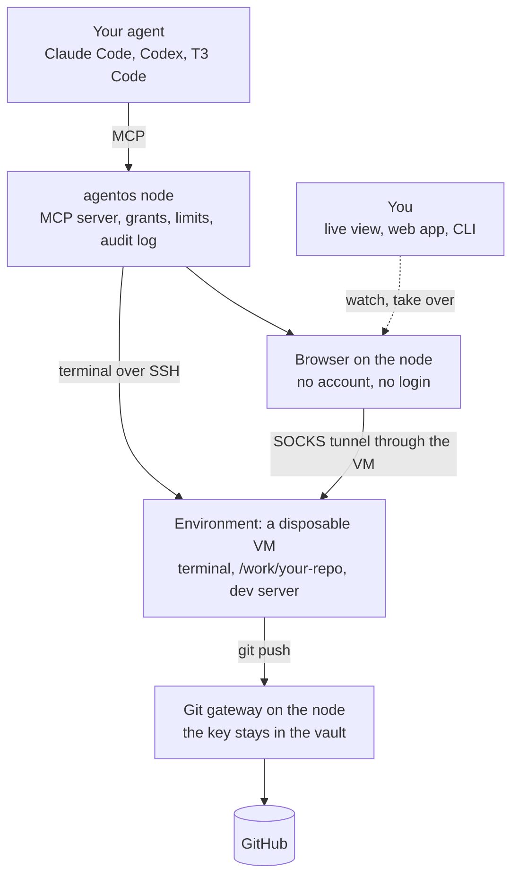
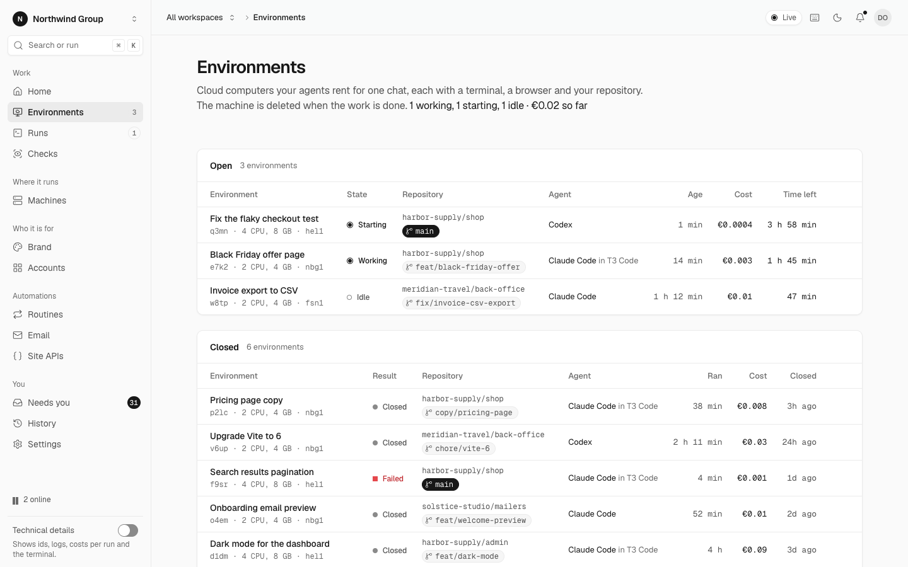

<p align="center">
  
</p>

<h1 align="center">agentos</h1>

<p align="center">
  <strong>Cloud dev environments for AI coding agents.</strong><br>
  A disposable VM with a terminal and a real browser for Claude Code, Codex and any MCP client.
  Self-hosted, open source.
</p>

<p align="center">
  <a href="https://github.com/sabalys-ramunas/agentos/actions/workflows/ci.yml"></a>
  <a href="LICENSE"></a>
  
  <a href="https://modelcontextprotocol.io"></a>
</p>

You open a chat and ask your coding agent to work in agentos. It asks for an **environment**: a
fresh VM with your repository, a terminal and a browser. It builds, runs the tests and checks the
page there, pushes a branch, and the VM is deleted. You watch its browser live, and take over
whenever you like.

<picture>
  <source media="(prefers-color-scheme: dark)" srcset="assets/readme/environment-dark.png">
  
</picture>

agentos is not another agent, chat or IDE. It is an [MCP server](https://modelcontextprotocol.io)
(Model Context Protocol) that runs on a machine you own and rents short-lived machines for the
agent you already use.

## How it works



1. The agent calls `environment_open(title="Fix checkout", repo="github.com/you/shop")`. The node
   rents a VM (Hetzner Cloud, or a Docker container on your own computer), clones the repository
   into `/work/shop` and opens a browser whose traffic leaves from that VM.
2. Calls without a target go to that environment: `lane_exec(cmd="npm test", cwd="/work/shop")`,
   `lane_job_start(cmd="npm run dev", cwd="/work/shop")`,
   `browser_navigate(url="http://localhost:3000")`. In the browser, `localhost` is the VM.
3. `git push` on the VM goes through the node's git gateway. The VM never holds your key, only a
   token for that one repository, which dies with the environment.
4. `environment_close()` refuses while work is not pushed, then deletes the VM and the browser.
   If the agent forgets, the node closes it when it sits idle or reaches its time limit.

**A real run**, from Claude Code in T3 Code: a Hetzner `cx23` in Nuremberg was ready about 1.5
minutes after `environment_open`, with no approval. The agent cloned this repository through the
gateway, ran `pnpm dev` on the VM, and its browser opened in T3 Code's preview pane. `ui_check`
found text at 4.47:1 contrast (WCAG AA asks for 4.5:1); the agent fixed it on the VM, `ui_check`
confirmed the fix, the commit went up as a branch, and the environment closed. 13 minutes,
0.01 EUR.

## Why not just run the agent on your laptop?

- **Your laptop stays yours.** Builds, test suites, dev servers and browsers run on the VM. Close
  the lid and the work carries on.
- **Nothing the agent runs can reach your keys or accounts.** The VM holds no login, no key and no
  password, so it can run anything without asking you each time.
- **A real browser.** The agent sees its own dev server the way a user would, and so do you.
- **Every chat starts clean.** One environment per chat, deleted when it is done: no leftovers
  from the last task, no "works on my machine".

## Quickstart: Docker on your laptop (5 minutes)

You need git, [uv](https://docs.astral.sh/uv/), Docker running, and
[Claude Code](https://claude.com/claude-code) or Codex. Each environment is an Ubuntu container
with SSH instead of a cloud VM.

```sh
git clone https://github.com/sabalys-ramunas/agentos && cd agentos
uv sync --extra studio
mkdir -p ~/agentos-try && echo 'provider = "docker"' > ~/agentos-try/vms.toml
uv run agentos dev up --home ~/agentos-try
```

`dev up` starts a node on `127.0.0.1:7450` and registers it with Claude Code and Codex (when they
are installed) as `agentos-dev`, with the `agentos-environment` skill. Leave it running. In a
second terminal, build the environment image once (a few minutes):

```sh
export AGENTOS_HOME=~/agentos-try
uv run agentos environments setup --build
```

Connect the repository the agent should work on. One command makes a deploy key on the node and
prints its public half to paste into the repository's deploy keys (with write access), or stores a
fine-grained token with `--token`. A public repository clones without this, read only; a private
one that is not connected is refused before anything is rented, with this command in the error.

```sh
uv run agentos environments repo add github.com/you/app
```

Now start a new Claude Code session and ask:

> Work on this in agentos: clone github.com/you/app, start the dev server, check the home page
> with ui_check, fix what it finds, push a branch and close the environment.

The agent gives you a live view link (`http://localhost:7450/view/...`) to watch its browser.
`uv run agentos environments list` shows what is open, and `uv run agentos environments close ID`
closes one. On the dev node the account lanes are simulated; the environment's container, terminal,
browser, git and studio's checks are real.

## Real cloud: Hetzner

A node is a Linux machine that runs agentos: Ubuntu 22.04 or later, or Debian 12, x86_64 or
arm64 (a small VPS is enough). Make a Hetzner Cloud project that holds nothing but these VMs, and a
read-write API token in it. On the node:

```sh
git clone https://github.com/sabalys-ramunas/agentos && cd agentos
sudo deploy/install-node.sh --systemd --user agentos --hardened
sudo agentos vm setup                      # paste the Hetzner token
sudo agentos vm image build dev            # a snapshot with git, build tools, Python, Node 22, Docker
sudo agentos environments repo add github.com/you/app   # a deploy key to paste, or --token
sudo agentos environments setup            # says what is still missing, and the command that fixes it
```

Then, from your computer (the node in your `~/.ssh/config` as `mynode`):

```sh
curl -fsSL https://raw.githubusercontent.com/sabalys-ramunas/agentos/main/scripts/install.sh | sh
agentos connect mynode
```

`connect` keeps an SSH tunnel to the node, gives your agents a grant of their own (kept in the
macOS Keychain or a chmod 600 file), registers the MCP server with Claude Code and Codex, and
installs the Claude Code skills. The node rents the cheapest server type that fits, unless you set
a size. Install, hardening, backups and upgrades: [deploy/README.md](deploy/README.md).

## Works with

| Client | How it connects |
|---|---|
| **Claude Code** | `agentos connect` registers it (`claude mcp add-json`) and installs the `agentos-environment`, `agentos-studio`, `agentos-lanes` and `agentos-offload` skills |
| **Codex** | `agentos connect` adds it to `~/.codex/config.toml`, through the stdio bridge `agentos mcp-bridge` |
| **T3 Code** | nothing more: its Claude threads read Claude Code's settings and its Codex threads read Codex's; open the live view in its preview pane |
| **Any other MCP client** (Cursor, for example) | by hand: the node's MCP URL over Streamable HTTP with a grant token; `agentos connect --by-hand` on the node prints the steps |

## What the agent gets

| Tool | What it does |
|---|---|
| `environment_open(title, repo, ref, size, hours)` | rents the VM (`size`: small, medium, large, xlarge), clones the repo into `/work/<name>`, opens the browser; returns the live view link for you |
| `environment()` | state, time left, cost so far, listening ports, git (branch, ahead, dirty, pushed), the last calls |
| `environment_close(discard=False)` | refuses with `unsaved_work` while anything is not pushed; then deletes the VM and the browser |
| `lane_exec(cmd, cwd)` | a command on the VM, with its output |
| `lane_job_start`, `lane_job_read`, `lane_job_cancel` | long jobs and dev servers on the VM |
| `browser_navigate`, `browser_snapshot`, `browser_act`, `browser_screenshot` | the environment's browser: read the page as an outline, act by reference |
| `ui_check(url)` | studio's page check at each width and theme: layout, contrast, tap targets, names, page health |

About 150 more tools, grouped in toolsets the agent loads when it needs them, are listed in
[docs/TOOLS.md](docs/TOOLS.md).

## Safety, in plain words

- **No key on the VM.** Git goes through the node's gateway, which keeps the credential in its
  vault. The VM holds one gateway token: good for the repository it was opened with, only through
  its own tunnel, and only while it is open. A force push or a delete of the default branch is
  refused.
- **Nothing inside asks you.** Because the VM holds nothing worth stealing, commands, the browser
  and pushes there never wait for a person, even after the agent read a web page.
- **Limits instead of questions.** By default at most 3 environments open at once, 8 hours each,
  and 50 EUR a month. Past a limit the open is refused, whatever the agent read. Set your own with
  `agentos environments allow --max-live 2 --max-hours 4 --monthly-eur 20`
  ([the limits](docs/ENVIRONMENTS.md#4-the-limits)).
- **Deleted when done.** The node closes a forgotten environment after an idle hour or at its time
  limit. One with unsaved work is never deleted for being idle: it waits to its time limit, and you
  are told first.
- **One agent's machine.** Only the agent that opened an environment can see it or act on it. You
  see and close every one.
- **The audit log.** Every call, tied to the grant that allowed it. `agentos access freeze node`
  stops every agent at once.
- **Your own accounts stay behind a person.** Logged-in browser lanes for your accounts are a
  separate feature, and there posts, payments and secrets after untrusted text still ask you.

What this defends against, and what it does not: [docs/THREAT-MODEL.md](docs/THREAT-MODEL.md).

## Watch it work

The web app (`web/`, served by the node at `/`) lists every environment with its state, repository,
agent, cost and time left, and gives each one a page with its live browser, terminal commands, git
and ports. Build it once with Node.js 22 and pnpm: `cd web && pnpm install --frozen-lockfile &&
pnpm build` ([web/README.md](web/README.md)).

<picture>
  <source media="(prefers-color-scheme: dark)" srcset="assets/readme/environments-dark.png">
  
</picture>

Without a build, the live view link the agent gives you works on its own. Here is the live view
of a real environment on Hetzner: its browser shows the VM's own `localhost:3000`, and
**Take control** lets you drive it:


The CLI shows the same: `agentos environments list`, `show ID` and `close ID`.

## More features

- **Studio page checks**: `ui_check`, `ui_diff` and `system_check` measure the pages you build at
  each width and theme, and say what a change did ([docs/STUDIO.md](docs/STUDIO.md)).
- **Profiles and brand**: who the work is for, with tokens and rules that `ui_check` measures
  ([docs/PROFILES.md](docs/PROFILES.md)).
- **Browser lanes for your own accounts**: persistent, logged-in browsers with their own proxy,
  which you watch and take over ([docs/PROXIES.md](docs/PROXIES.md),
  [docs/RESPONSIBLE-USE.md](docs/RESPONSIBLE-USE.md)).
- **Routines**: flows you record and replay, and workflows on a schedule
  ([docs/WORKFLOWS.md](docs/WORKFLOWS.md)).

## FAQ

### How is this different from running the agent locally?
The agent still runs where it runs now (your terminal, T3 Code, Codex). Only its work moves: the
commands, the dev server and the browser run on a VM that holds none of your keys or accounts, so
it can work without asking you at each step, and your laptop stays free.

### How is it different from E2B, Daytona or GitHub Codespaces?
E2B and Daytona are sandbox platforms that your own code drives through their SDKs and APIs; they
fit well when you build a product that runs code for your users. Codespaces is a hosted dev
environment for a person in an editor. agentos is for the agent in your chat: it is an MCP server
the agent calls itself, with a real browser you can watch and take over, git through a gateway so
the key stays off the machine, and limits and an audit log on a node you run.

### What does it cost?
agentos is free (Apache-2.0). You pay your provider: Docker costs nothing, and a Hetzner `cx23`
(2 vCPU, 4 GB) is about 0.011 EUR an hour, billed per started hour. The real run above, 13 minutes
from open to close, cost 0.01 EUR. `environment()` and the web app show the cost so far.

### Is my code or my key on the VM?
Your code is: the repository is cloned there, so the agent can work on it. Your key is not, and
neither is any token, password or account. Pushes go through the node, which holds the key.

### Can I self-host it?
It is self-hosted. The node runs on your own Linux server or laptop, and the VMs are rented with
your own provider account. There is no agentos account and no hosted service in the loop.

### Which providers are supported?
Docker (any computer with Docker) and Hetzner Cloud. The provider layer (`agentos.vms`) is small,
and more are welcome.

### Which agents work with it?
Claude Code and Codex are set up by `agentos connect`; T3 Code uses both. Any client that speaks MCP
over HTTP can connect by hand (see [Works with](#works-with)).

## Status

**Alpha.** Environments are new in 0.1.0; expect the most change there. Not yet: providers other
than Docker and Hetzner, a file copy tool for the VM (files move through commands and git), and a
link to a VM's port on your own computer (you see it through the environment's browser). The full
list: [docs/ENVIRONMENTS.md](docs/ENVIRONMENTS.md#limits) and
[docs/ARCHITECTURE.md](docs/ARCHITECTURE.md#not-built-yet).

## Docs

| | |
|---|---|
| [docs/ENVIRONMENTS.md](docs/ENVIRONMENTS.md) | environments: setup, use, costs, limits, troubleshooting |
| [docs/design/environments.md](docs/design/environments.md) | the design and the exact tool shapes |
| [docs/GIT.md](docs/GIT.md) | git through the node: keys in the vault, declared repositories |
| [deploy/README.md](deploy/README.md) | install, harden, back up and upgrade a node |
| [docs/NODE-TEMPLATES.md](docs/NODE-TEMPLATES.md) | Hetzner, home box and Mac mini templates |
| [docs/TOOLS.md](docs/TOOLS.md), [docs/ERRORS.md](docs/ERRORS.md) | every MCP tool, every error code and its fix (generated) |
| [docs/STUDIO.md](docs/STUDIO.md) | studio's page checks |
| [docs/ARCHITECTURE.md](docs/ARCHITECTURE.md), [docs/VISION.md](docs/VISION.md) | how it is built, and where it is going |
| [docs/THREAT-MODEL.md](docs/THREAT-MODEL.md), [docs/PRINCIPLES.md](docs/PRINCIPLES.md) | what it defends against, and the lines it will not cross |
| [docs/DEVELOPING.md](docs/DEVELOPING.md) | the dev loop, the tests, the fake node |
| [docs/design/README.md](docs/design/README.md) | the design docs, with what is built and what is not |

## Contributing

Issues and pull requests are welcome. [CONTRIBUTING.md](CONTRIBUTING.md) has the dev loop (no
cloud account needed: `uv run agentos dev up` and the unit tests run on a laptop). For a security
problem, see [SECURITY.md](SECURITY.md) and report it privately.

## License

Apache License 2.0: see [LICENSE](LICENSE) and [NOTICE](NOTICE).
