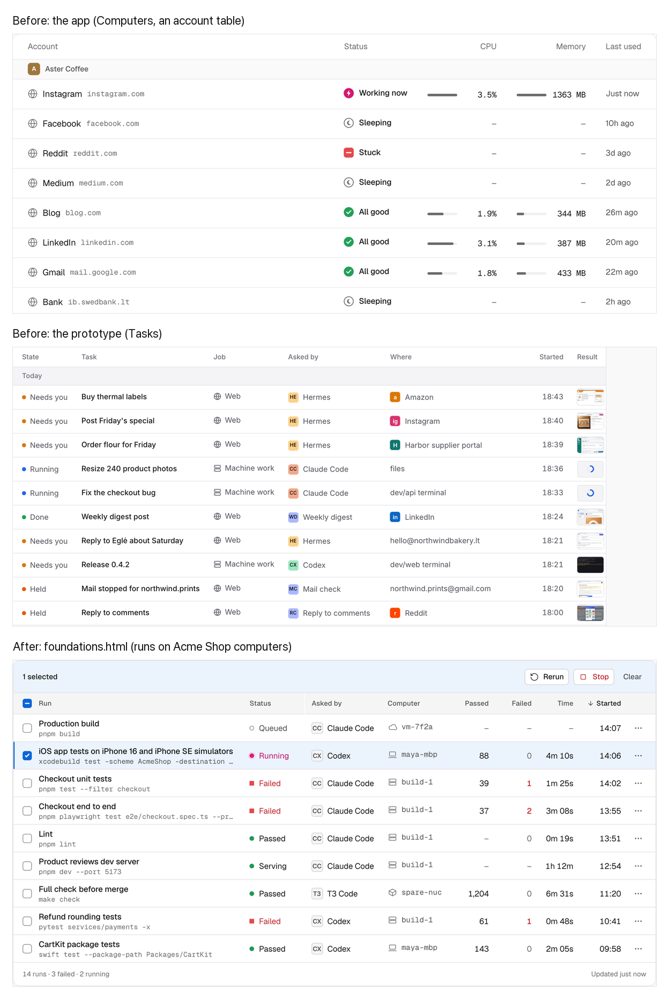
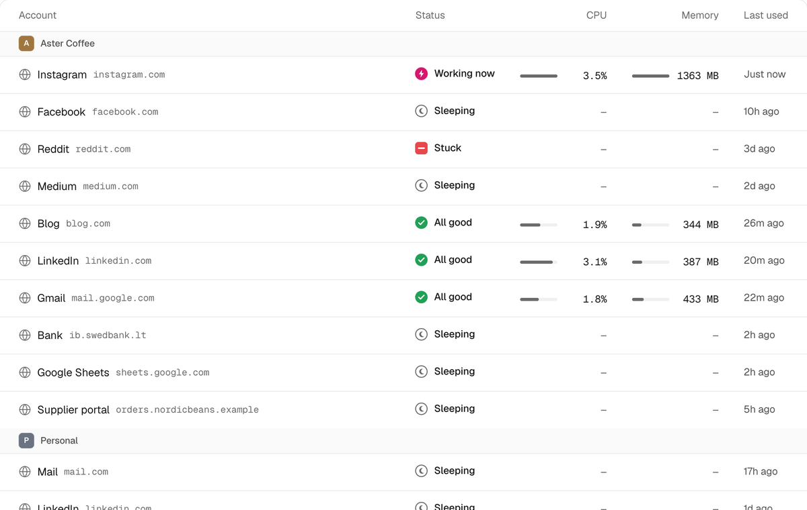
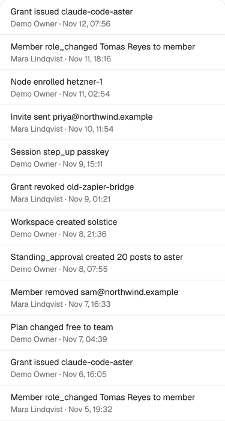
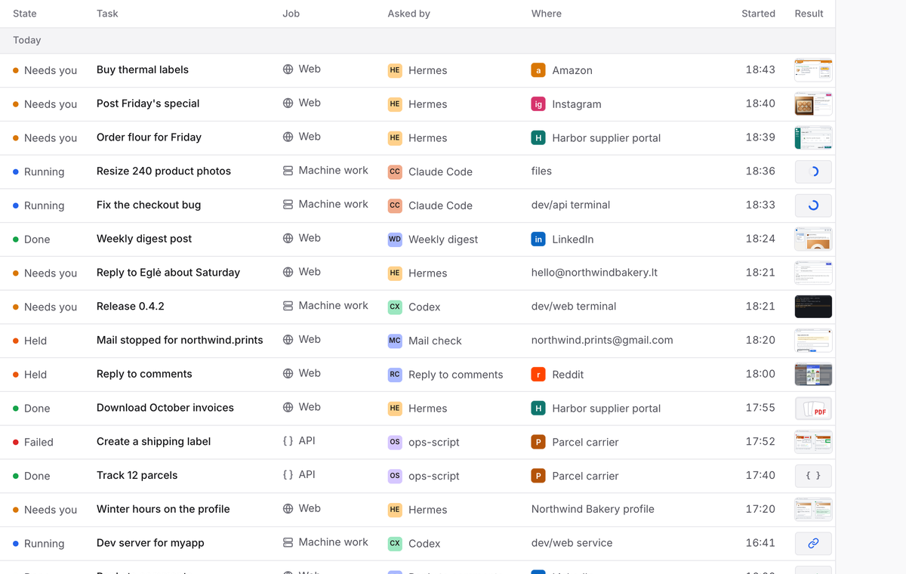
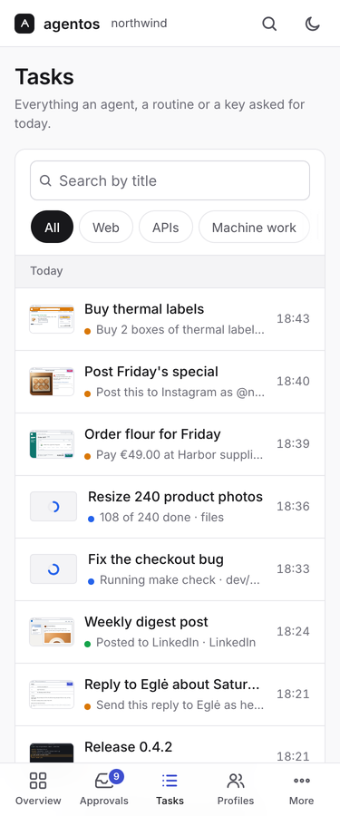
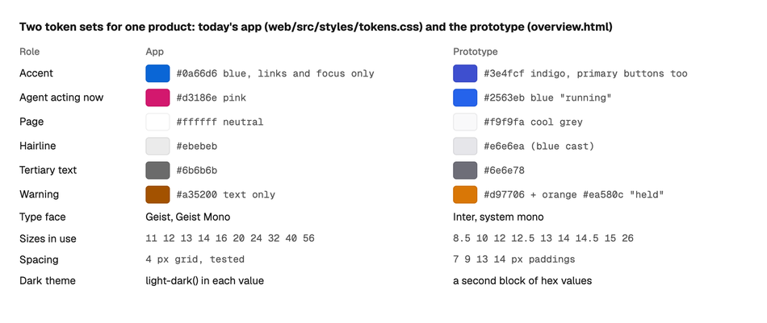
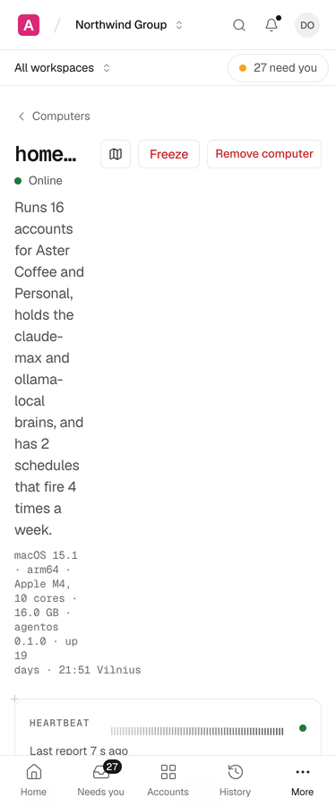

# Foundations: tokens and base components

Status: design, 2026-11-12. Owner's words: "basic tokens like table headers need a lot of work."
Built by D1 on the design wave that moves agentos toward developers' and designers' work.

The files:

| File | What it is |
|---|---|
| `panel/prototypes/dashboard/foundations.html` | Every primitive in every state, both themes, phone to desktop. Tables first. |
| `panel/prototypes/dashboard/tokens.json` | The token set as Design Tokens (DTCG 2025.10), a `base`/`light`/`dark` themes map. |
| `panel/prototypes/dashboard/tokens.css` | The same set as CSS custom properties. |
| `panel/prototypes/dashboard/build-tokens.py` | Where the values live. Writes both files, checks 88 contrast pairs, fills the page's pair table. |
| `panel/prototypes/dashboard/assets/` | The Acme Shop checkout picture, and Geist (OFL) as data URIs so the page works from disk. |
| `docs/design/foundations/` | The pictures in this document. |

Open `foundations.html` straight from disk or over any static server. `?theme=dark` or the switch in
the corner pins a theme; otherwise it follows the system.



## 1. Audit

What was weak, inconsistent or missing in `web/src` (tokens.css, `components/ui`) and in the
prototype (`overview.html`). Tables first, because the owner named them.

### Tables



1. **The header reads as metadata, not as a header.** `Th` is 13 px, weight 400, `text-faint`, on the
   card's own white. A row's second line uses the same colour and nearly the same size, so the eye
   finds no top edge. Header and values do not differ in kind, only in position.
2. **No sorting anywhere.** No sortable head, no sorted state, no `aria-sort`, nothing in the
   primitive for it. Every table in the app is in one fixed order.
3. **No sticky header.** Settings, Audit log is 50 rows; the header scrolls away after six.
4. **Numbers are two fonts in one column.** "1363 MB" is Geist Mono, "Just now" in the next column is
   Geist; CPU puts a meter and a mono number under a head that sits over the number only. The unit
   is repeated in every cell.
5. **No selected state, no keyboard row focus, no density.** `mainCell` truncates with an ellipsis and
   offers no way to read the rest (no tooltip, no title).
6. **The phone form drops the header and the order.** Audit log at 375 px is one long run of
   two-line rows: no header, no sort, times in proportional figures, 50 rows with no grouping.

   

The prototype's tables have the same root problem from the other side:



7. **The group row outweighs the header.** "Today" is a grey band, 12 px weight 500 on `--sunken`,
   heavier than the column heads (12 px, 500, `--text-3` on white). The hierarchy is upside down.
8. **Status leads the row.** The first column is a dot and a word, so scanning down the left edge reads
   "Needs you, Needs you, Running". The thing's name is second.
9. **Pictures in a cell carry states they cannot show.** The Result column is a thumbnail, and for a
   running task it is a spinner in a picture slot.
10. **On a phone, titles truncate with no way to read them.** "Reply to Eglė about Satur..." and
    nothing opens it but the whole row.

    

### Tokens



11. **Two token sets for one product.** The app is neutral grey, blue accent for links and focus, pink
    for an agent acting now, Geist. The prototype is cool grey, an indigo accent that also fills
    primary buttons, blue for "running", Inter. Nothing maps one to the other.
12. **Type is named by size, not by job.** `text-13`, `text-14`. There is no "table header" role, so
    each table picks its own: 13/400 faint in the app, 12/500 in the prototype.
13. **Status has four parallel sets with different values for one meaning.** `--green` (#1f7a3a) for
    text, `--ok-dot` (#22a057) for glyphs, `--mark-verified` for charts, `--ok-soft` for tints. The
    warning dot `#f5a524` is 2.0:1 on white, under the 3:1 a mark needs.
14. **Identity hues fail for small initials.** White on teal `#3f9a8c` is 3.4:1; avatars use 11 px
    initials, which need 4.5:1.
15. **Off the grid in the prototype.** Sizes 8.5, 12.5, 14.5 and 26 px; paddings of 7, 9, 13 and 14 px.
    Measured with studio against the prototype's own variables (Tasks, 1440, light): colour 55% on a
    token, radius 34%, shadow 4%, and 616 values that only look like a token.
16. **The app cannot be measured for colour.** Every colour is written with `light-dark()`, which
    studio does not read as a token yet. Against its own variables (a computer's accounts table, 1440, light),
    spacing measures 95%, font weight 97%, line height 0% and radius 55% (`9999px` pills and a 36 px
    corner), with 96 values that only look like a token.
17. **Shadows used as lines.** Both codebases draw edges, rings and indicators with `box-shadow`, so
    a selected edge or a tab underline is invisible to any token check.
18. **Page header breaks on a phone** (not a table, but the same primitives). A computer's page at 375
    px squeezes the title to "home..." and its sentence into a 150 px column, because the three
    actions keep the first row.

    

## 2. The token set

163 tokens, 246 values once both themes are counted. Light is the default; dark comes from the
system unless `data-theme` pins one.

### Main choices, and why

- **One neutral ramp, 13 steps, pure grey.** 0 to 12 by luminance, the same step numbers in both
  themes. Pure grey because the product's colour is spent on meaning (status, the agent acting now),
  and a blue cast makes those colours look dirty. 13 steps gives surfaces (0 to 3), hairlines (5, 6),
  a control edge at 3:1 (8) and three text levels (9, 10, 12) without in-between values.
- **Page and card are different surfaces.** Light: page `#fafafa`, card white; dark: page `#0a0a0a`,
  card `#141414`. This breaks DESIGN.md ("page and cards share one colour"). Reason: a dashboard of
  tables and cards reads as one sheet when they share the page colour; one step apart, a card's edge
  holds without a shadow and the hairline can stay quiet.
- **Roles, not steps.** Screens use `surface.*`, `line.*`, `text.*`. The ramp exists so the roles can be
  re-derived, not to be picked from.
- **One accent: blue.** Kept from the app (`#0a66d6` fill, `#0a5fc7` text so it passes 4.5:1 on its
  own tint). The prototype's indigo is dropped. The accent is links, selection, focus, checked and
  progress. The primary button stays solid ink, as DESIGN.md says.
- **Status in four parts.** ok, warn, bad, live, idle, each with `text` (4.5:1 on every surface and on
  its own fill), `dot` (3:1 on cards), `fill` (a tint) and `line` (a tint's edge). One family per
  meaning replaces the four parallel sets. `live` is the app's pink: an agent acting right now, never
  decoration. The prototype's blue "running" and orange "held" are gone. The warning dot is darker in
  light (`#cf7c00`, 3.2:1) so it passes as a mark. `status-ink` (`#111111`) is for a number on a dot.
- **Shape carries status too.** Dot fine, diamond needs a look, square failed, ringed dot acting now,
  hollow ring idle. Colour never stands alone.
- **Type by role.** 13 roles: page title, section title, card title, table header, label, body,
  secondary, caption, number, stat, code, code caption, micro. Each is a DTCG typography token
  (family, size, weight, line height, tracking). Tracking is in px per role because DTCG dimensions
  allow only px and rem.
- **The table header role** is 12/16, weight 500, `text.secondary`, sentence case, +0.12 px tracking.
  Smaller than the cells so it never competes; one weight up and one text level up from today so it
  reads as the top edge.
- **Space on the 4 px grid**, plus `space.px` (1 px) for the hairline gap between tiles. No 6, no 10.
- **Rows:** 36 compact (one line), 48 default (a title and a second line), 56 relaxed. Header band 36.
  Controls 28, 32, 40, and small controls grow to 32 on a touch screen.
- **Radius:** 4, 6, 8, 12 and full. **Elevation:** two shadows, popover and dialog, for floating layers
  only. **Focus:** 2 px `focus.ring`, 2 px out, inset inside clipped containers.
- **Motion:** 120, 150, 180 ms on a standard curve, an enter curve for what arrives; the app's values,
  unchanged. Reduced motion sets all three to 0.
- **Layers:** sticky 10, header 20, dropdown 30, overlay 40, dialog 50, toast 60, tooltip 70.
- **Identity hues** for people and workspaces, darkened where white initials missed 4.5:1 (four of
  eight).
- **Terminal and ANSI** follow the theme: a light log in light, a dark one in dark, every ANSI colour
  4.5:1 on its background. **Diff** fills and marks, and **chart** tokens (line, area, bar, the bar that
  is the point, grid).

### Contrast pairs that pass AA

`build-tokens.py` checks 88 pairs in both themes and stops if one falls short. The full table, sortable,
is on the page under Colour. In short:

- `text.primary`, `text.secondary`, `text.tertiary` and `accent.text` on page, card, inset, raised and
  `accent.soft`: 4.5:1 or more. Tightest: tertiary on `fill.pressed` over a card, 4.56.
- Each status `text` on page, card, inset and its own `fill`: 4.5:1 or more.
- `text.inverse` on `surface.inverse`, on `accent.fill` and on `text.primary` (the primary button).
- Terminal text, dim text and six ANSI colours on `terminal.bg`.
- `text.primary`, `text.secondary` and the mark on each diff fill.
- 3:1 for marks and edges: `line.control` and `focus.ring` on every surface (tightest 3.17), each
  status dot on a card, `accent.fill`, `chart.line` and `chart.bar-strong`.
- White initials on all eight identity hues and the brand mark, and `status-ink` on the ok, warn and bad
  dots: 4.5:1 or more.
- Not checked on purpose: `text.disabled` (disabled controls are exempt and nothing to be read uses it).

On a tint (a selected row), quiet lines step up from tertiary to secondary text. The pair passes on
paper (4.76), but anti-aliased 12 px text measures lower in pixels, and the step costs nothing.

### Keeping the two files in step

Edit `build-tokens.py`, run `python3 panel/prototypes/dashboard/build-tokens.py`, commit the three
outputs. Studio's own loader reads both files to the same 246 values (the only differences are in the
fifth decimal of an oklab channel, from hex rounding):

```python
from agentos.studio.tokens import load_tokens
a = load_tokens("panel/prototypes/dashboard/tokens.json")
b = load_tokens(open("panel/prototypes/dashboard/tokens.css").read(), fmt="css")
```

## 3. The primitives

Each is on the page with a line on when to use it and its rules, in every state, at 375, 768 and 1440,
light and dark. The table rules in full, since they were the ask:

- **When:** comparing the same facts across many things. One thing read on its own is a list row.
- **Header:** the table header role, on the inset band, 36 px, one hairline under it, sticky in its
  scroll box. The label starts where its values start (12 px cell padding, 16 at the table's edges).
- **Sort:** the whole head is the button. Sortable heads show an up-down arrow on hover and focus;
  the sorted head turns `text.primary` with a direction arrow and `aria-sort`. The arrow sits on the
  label's far side (after it on a left column, before it on a right one), so the label never moves.
- **Numbers:** anything made of digits aligns right with tabular figures, head included. Units live in
  the head in `text.tertiary`. A missing value is an en dash in `text.tertiary`; a zero is a zero.
- **Primary cell:** takes the spare width (at least 220 px, 160 under 1024), truncates, shows its full
  text in a tooltip on hover or focus and always in the row's sheet. Its second line is the code
  caption role.
- **Rows:** hover `fill.hover`; selected `accent.soft` with a 2 px accent bar on the left; keyboard
  focus is the focus ring around the row. Arrow keys move, Space selects, Enter opens the sheet.
  Selecting swaps the toolbar for the bulk actions.
- **Status:** mark and word. The word takes its status colour only when it asks for attention
  (failed, needs you, acting now); fine and idle stay in ink.
- **Actions:** a ghost icon button, always visible, with a name; its head has a hidden name.
- **Density:** compact drops the second line.
- **Loading:** skeleton rows with the real header and row height. **Empty:** the header stays, and the
  body says what would be here and the next step. **Error:** what happened, that nothing changed, Try
  again.
- **Under 1024:** secondary columns fold away (Asked by, Passed). **Under 768:** the table becomes a
  list: title, then status and counts, then computer, agent and branch, with the time and actions on
  the right, and the sort in a select above.

The other primitives: list rows, buttons and icon buttons, inputs, select, search, checkbox, switch,
tabs, segmented control, badges and status marks, cards and stat tiles, page header, toolbar,
breadcrumb, sheet, dialog, menu, tooltip, toast, empty state, skeleton, progress (bar, moving bar,
steps), keyboard key, code and code block, terminal with ANSI colours, diff, sparkline, small bar
chart, avatar, workspace and agent marks, the agentos mark, and an image frame with findings outlined
on a real picture of a page.

## 4. Studio results

Run from a scratch HOME (`agentos studio up`, port 7471), page served over http.

**ui_check**, 375, 768 and 1440, light and dark (6 screens):

| Run | Findings | Real |
|---|---|---|
| First (`run_o73g08oyhq`) | 56 (46 major) | about a dozen: white numbers on amber and red pins, white initials under 4.5:1 on three hues, a slash and dot separators in the disabled grey, theme buttons with no name on a phone, a toast example 128 px too wide, a 20 px shift (facts filled by script), the example sheet covering its caption, phone truncations that should wrap |
| Last (`run_ovw1d8s5dc`) | 41 (37 major) | none: 35 rows scrolled out of view inside a scroll box, 2 disabled labels (exempt), 1 picture at 2x, 3 truncations with a tooltip and a sheet |

**system_check** against `tokens.json`, the same 6 screens (`run_2wyf7obuib`): clean. 100% of colour,
space, radius, font family, size, weight, line height, border width and shadow on a token; 0 values
that only look like one. It took two rounds: the first found every box-shadow I had used as a line,
the hr's default grey, the html element's default colour and a 1 px gap. Each was a real
inconsistency and is fixed (lines are now borders, outlines or a 2 px bar on a token colour).
No exceptions remain.

### Where studio was wrong or awkward

1. **Scroll boxes again.** 35 of the last 41 findings are rows scrolled out of view inside a scrolling
   table, reported as covered by whatever sits under the box. Its crop of one shows the table footer
   where the hidden checkbox would be. Already on the list from design v2; it is most of the noise on
   any page with a sticky-header table.
2. **Disabled controls' labels fail contrast.** A label of `input[disabled]` and of a switch with
   `aria-disabled` is checked as body text. WCAG 1.4.3 exempts inactive components.
3. **Any `::before` sends contrast to pixels.** `why_pixels: "pseudo"` fires for a 2 px bar on the
   row, nowhere near the text, and anti-aliasing then reads 12 px text about 0.8 lower than its real
   4.76:1.
4. **`transparent` counts as an off-token colour** (`#00000000`, 20 times on ghost buttons).
5. **A box-shadow line is judged as a shadow.** An inset 2 px edge in a token colour is "off the system"
   because the whole shadow is matched, not its colour and width. It pushes authors to pseudo-elements.
   (Here that was the right push, but the check could split colour and geometry.)
6. **A 1 px gap needs a space token.** Gap set from `--border-width-hairline` reads as hard-coded 1 px.
7. **`tokens` as JSON text does not arrive as text.** Passing the DTCG file's contents gave "tokens:
   Input should be a valid string"; it seems to be parsed into an object on the way in. Only a file
   path worked. The tool text says JSON text is accepted.
8. **Truncation does not know about tooltips.** A cell whose full text is a hover, a focus and a sheet
   away is `reachable: false`.
9. **Finding ids follow the selector.** `f_e6d6376f89` first meant "88 passed" on one row and, after a
   fix, "14:06" in the same place. Confusing in a `since` delta.
10. **`ui_image` crops a finding to its exact box.** A covered checkbox is a 16 by 16 px picture with no
    surroundings, which says nothing.
11. **A 2x screenshot is "oversized"** when checked at device pixel ratio 1. 2x is the normal asset.
12. **Fonts change the results.** With Google Fonts the stylesheet is cross-origin and system_check
    notes it could not read it; with `display=optional` studio's fresh browser renders the fallback
    every time and says so. A web font swap showed as a layout shift at one width, in some runs only.
    Waiting for `document.fonts.ready` before measuring would settle both.
13. **Deltas are strings.** With `since`, `fixed` and `still` are one-line strings, and `detail: "full"`
    does not expand them, so reading the details took one `finding_get` per id.
14. **DTCG typography loses tracking.** Only family, size, weight and line height are read, so letter
    spacing is never checked.
15. As in design v2: the agent token is only in the `studio up` banner, and under a scratch HOME
    Firefox and WebKit are reported missing.

## 5. Rebuilding web/ on these foundations

What a builder must know.

1. **Copy the two token files** into `web/src/styles/` in place of `tokens.css`'s contents (keep the
   instrument, board, field and night tokens in a feature file on top: they are not foundations).
   Move `build-tokens.py` with them and add a test that the two files load to the same set.
2. **Rename, do not re-pick.** `--background` is `--surface-card`, and the page behind it is now
   `--surface-page`. `--background-subtle` is `--surface-inset`, `--background-raised` is
   `--surface-raised`. `--fill-1`, `--fill-2` are `--fill-hover`, `--fill-pressed` (`--fill-3` goes).
   `--border`, `--border-strong`, `--control` are `--line-default`, `--line-strong`, `--line-control`.
   `--foreground`, `-muted`, `-subtle`, `-disabled` are `--text-primary`, `-secondary`, `-tertiary`,
   `-disabled`. `--blue` and `--focus` are `--accent-text`, `--accent-fill`, `--focus-ring`.
   `--green`, `--amber`, `--red` are `--status-ok-text`, `-warn-text`, `-bad-text`; `--ok-dot` and the
   other glyph colours are `--status-*-dot`; `*-soft` is `--status-*-fill`; `--current` is
   `--status-live-dot` and `--status-live-text`. `--ws-1` to `--ws-8` are `--identity-1` to `-8`
   (four are darker). `--brand` is `--brand-mark`.
3. **Drop `light-dark()`.** This breaks a DESIGN.md rule on purpose: studio cannot read `light-dark()`
   tokens, DTCG needs a value per theme, and the generated CSS keeps "system needs no JavaScript"
   (a `prefers-color-scheme` block for the system, `data-theme` for a pinned choice).
4. **Map Tailwind to roles.** In `app.css`'s `@theme`, map `--color-*` to the new names and generate one
   text utility per type role (`text-page-title`, `text-table-header`, `text-code-caption` ...) that
   sets all five properties. Retire `text-11` to `text-56`.
5. **Table** (`components/ui/table.tsx`): `Th` takes `sort` (`'asc' | 'desc' | undefined`), `onSort`
   and `align="end"`; it renders the head as a button, the arrow on the far side and `aria-sort`, on
   the inset band, sticky. `Tr` takes `selected`; `Td` takes `numeric` (right, tabular). Density on the
   table. `mainCell` gets its min-width. Under 768 render the list form, not hidden cells: this
   replaces DESIGN.md's `hidden md:table-cell` rule. Every truncating cell gets the tooltip.
6. **Status:** one `Status` with five kinds and the five shapes. `StateBadge`'s words stay; its colours
   come from the status family.
7. **No box-shadow lines.** Selected edges, tab underlines, rings and diff edges are borders, outlines or
   a pseudo-element bar on a token colour, so system_check can see them.
8. **Check with studio.** `system_check` with `tokens=<path to tokens.json>` on the main routes in CI,
   expecting 100% and no look-alikes; `ui_check` at 375, 768 and 1440 in both themes.
9. **DESIGN.md changes** that go with it: page and card surfaces differ; the table header role
   replaces `text-faint` heads; `light-dark()` goes; the phone table is a list; the warning dot and four
   identity hues are darker; ghost buttons have no border.

Order: tokens and the Tailwind map first (one PR, screens unchanged apart from colours), then the
table and status primitives, then each screen's tables.

## Pictures

Committed, in `docs/design/foundations/`: the before and after sheet above, `after-table.png` and
`after-table-dark.png`, `after-header-anatomy.png` (and dark), `after-phone-form.png`,
`after-table-768.png`, and the audit pictures.

Every screen at 375, 768 and 1440 in both themes, and the before set, are in
`panel/prototypes/dashboard/shots/foundations/` (git-ignored): `before/` holds the app's audit log,
members and computer tables and the prototype's Tasks; `after/` holds `page@<width>-<theme>.png`,
`table@...`, `anatomy@...` and `phone-form@...`.
